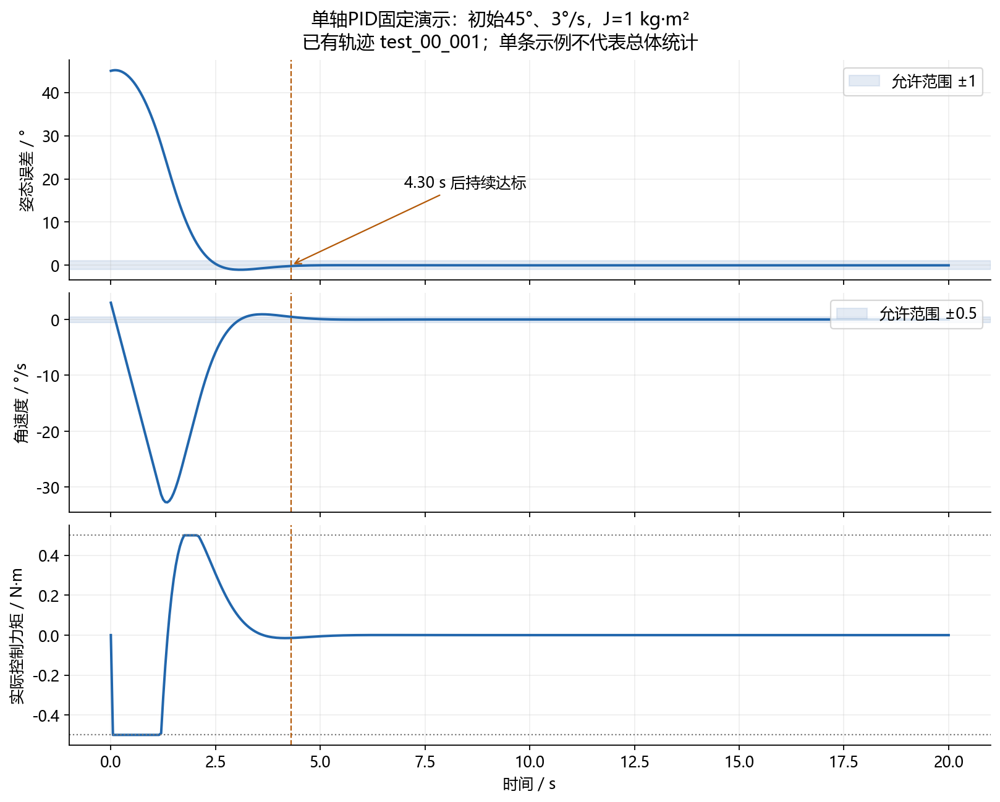

# 第二步：让单轴卫星先转得对、停得住

这一步先解决两个基础问题：**程序里的卫星是否按物理规律运动？不依赖AI时，一个认真整定的PID能做到什么程度？** 后面的学习算法只有放到同一个模型中，才能公平比较。

## 1．先把卫星想成一个只能绕单轴转动的盒子

假设目标方向是0°。盒子现在偏右45°，而且正以3°/秒继续向右转。控制器要先施加向左的力矩，把它拉回；在接近目标前，还要改变力矩方向刹车，避免冲过头。

惯量越大，同样力矩越难让转速改变。控制器施加的是“扭转作用”，即力矩，不是直接修改卫星的角度。角度必须通过角速度和动力学一步一步演化出来。

## 2．模型里的符号与单位

| 符号 | 含义 | 程序内部单位 |
|---|---|---|
| θ | 当前姿态角 | rad（图中换算成°） |
| ω | 角速度 | rad/s（图中换算成°/s） |
| J | 转动惯量，即转速有多难改变 | kg·m² |
| u | 执行器实际施加的力矩 | N·m |
| d | 外部扰动力矩 | N·m |
| Δt | 每次仿真前进的时间 | s |

动力学只有两条：`dθ/dt = ω`，`J·dω/dt = u+d`。第一条说转速决定朝向如何变化；第二条说净力矩除以惯量，决定转速变化有多快。

正式V1取J=1 kg·m²、步长0.05秒、总时长20秒，控制力矩不超过±0.5 N·m。每一步内把力矩保持不变，按`α=(u+d)/J`、`θ下一步=θ+ωΔt+0.5αΔt²`、`ω下一步=ω+αΔt`更新。角度与角速度使用更新前的状态共同计算，避免把刚更新的转速又重复代入角度公式。

## 3．PID究竟在做什么

记误差`e=当前角度−目标角度`，本项目控制律为`u=−Kp·e−Kd·ω+Ki·∫(−e)dt`，然后统一限幅。

比例P根据方向偏差拉回目标；微分D根据转速施加刹车；积分I累积长期偏差，尝试消除持续偏置。程序使用测得的角速度作D项，不对带噪角度直接差分。控制器还实现积分限幅和条件积分，防止力矩已经到极限时积分继续越积越大。

但“实现了积分保护”不等于“本次正式基线启用了积分”。在10个固定验证场景上搜索120组参数后，选中的是**Kp=4、Ki=0、Kd=3，实际属于PID族中的PD控制器**。此时积分项不起作用，解释结果时不能说它靠积分消除了扰动。

## 4．怎样选择参数与评价结果

参数只在验证集上选择，随后固定下来，才进入正式测试。测试初态覆盖±60°以内姿态角和±5°/秒以内角速度；同样初态会提供给后续PPO。不能先看哪个PID在测试集上最好，再反过来称它为独立测试结果。

正式成功要求最后5秒内，所有采样点的真实姿态误差都≤1°，且真实角速度都≤0.5°/秒。只经过一次零度线不算停稳。稳定时间指从该时刻开始直到仿真结束都不再超限；若没有达标，就记为空值，不能填0秒。

## 5．真实结果与读图方法

| V1正常工况PID统计 | 结果 |
|---|---:|
| 测试回合 | 50 |
| 成功率 | 100% |
| 平均稳定时间 | 3.367 s |
| 全程姿态误差RMS | 6.772° |
| 平均力矩平方积分 | 0.3432 (N·m)²·s |

数值来自[原始汇总表](支撑代码与数据/统计证据/summary.csv)中`PID/nominal_0`行。全程误差包含从初始偏角回正的过程，所以不应与末段误差混为一谈。

图是已有`test_00_001`轨迹的重新排版，初态为45°、3°/秒，没有重新仿真。先看上图角度回到0°附近，再看中图转速降下来，最后看下图力矩从回正方向切换到刹车方向。约4.30秒后该回合持续达标。它比表中3.367秒慢，是因为表是50个初态的平均，而图只是一组固定初态。

在V1的5个惯量等级0.6、0.8、1.0、1.2、1.4 kg·m²上，PID的250回合也全部达标。这已经说明惯量偏离标称值并不会自动使PID失效。有限测试全部成功仍不等于对任意惯量、任意初态都有保证。

## 6．这一阶段留下什么问题

模型仍是简化的单轴刚体，没有飞轮电气特性、飞轮动量上限或真实姿态估计链。±0.5 N·m只是仿真力矩限制。力矩平方积分表示控制动作的累计代价，不能直接换成电池耗电量或燃料消耗。

这一步建立了可信模型、可用基线与统一判据。接下来增加持续扰动、传感器噪声等条件，再让PPO在同一个环境里学习；由此进入[第三步](../03_实际影响与强化学习初探/本步讲解.md)。

代码、整定记录和固定轨迹的位置见[支撑材料说明](支撑代码与数据/阅读说明.md)。
