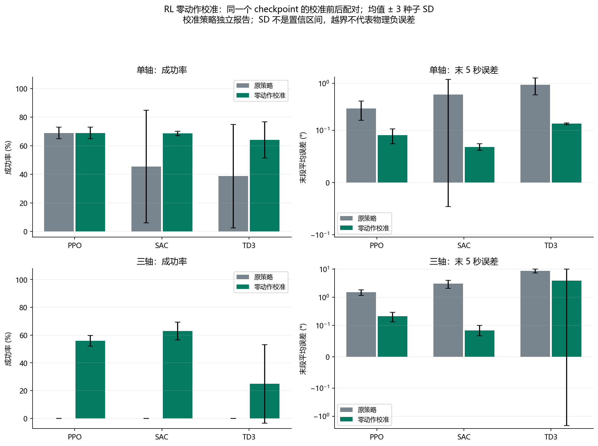

# 第03步：统一比较条件，再区分参数整定与策略部署的效果

**这一阶段回答三个问题：不同算法在同一任务中表现怎样；PID认真整定后还能提高多少；网络在目标点仍输出力矩，会不会破坏停稳？** 本步全部数字来自“07_单轴三轴多算法对比”的同一版正式结果，以下称第二版刚体比较。

## 1．为什么不能直接比较旧图

旧训练模型和图表的力矩限制、早停规则及误差窗口不同。有的程序首次进入角度阈值就结束，可能没有确认角速度已降下来。第二版因此在共同环境从零训练，仿真20秒，要求末5秒每个采样点同时满足误差≤1°、角速度≤0.5°/s，失败回合保留。

单轴使用2维观测、±0.5N·m，三轴使用6维观测、每轴±2N·m；同一任务内共享初态、扰动和噪声实现。所有方法不能读取真实惯量。两种任务的控制代价不能跨轴数直接排名。

## 2．三种强化学习方法分别怎样输出动作

| 方法 | 与本项目相关的机制 |
|---|---|
| PPO | 使用新采样轨迹更新策略，限制单次策略变化 |
| SAC | 经验回放、双价值估计和熵项探索，测试用确定性动作 |
| TD3 | 经验回放、双价值估计和延迟策略更新，测试关闭探索噪声 |

三者都输出连续力矩。共同奖励惩罚角误差、角速度及力矩平方，但奖励提高不等于持续停稳判据必然满足。

两任务×三算法×三个训练种子11、22、33，共18份从零训练记录。每份请求100万交互步；PPO实际执行1,001,472步，SAC和TD3各1,000,000步。相同交互步数不等于相同计算量。训练用于更新网络，16个固定验证场景用于选择检查点和PID参数，测试不参与选模。

每轴20组初态在9工况间复用，形成180场景；每份RL在这些场景上测试，算法统计合并三个种子为540回合。正式新比较共7,560回合，包括原控制器4,320回合、同模型部署校准3,240回合；另有720回合历史模型复测，不混入本步算法排名。

## 3．PID整定带来了什么

“原始PID”是可追溯历史基线；“整定PID”在验证集选择增益，三轴改用角速度阻尼并带积分保护；“滤波候选PID”进一步允许角速度低通滤波。常规搜索48候选，扩展滤波搜索144候选，预算差别公开。

| PID版本 | 单轴成功率 | 三轴成功率 |
|---|---:|---:|
| 原始 | 66.7% | 23.9% |
| 验证集整定 | 71.1% | 71.1% |
| 扩展滤波候选 | 71.1% | 72.8% |

三轴由23.9%到72.8%增加48.9个百分点，大部分发生在整定阶段。滤波仅比同增益整定版多成功3/180场景，代价也增加。单轴入选alpha=1，没有实际启用滤波；两轴入选Ki均为0，不能把提升归给积分抗饱和。增益整定与阻尼形式未作完整分项消融，所以三轴大幅改进归于整套方案。


图中成功率差值为正表示改善，误差差值为负表示改善。单轴某些误差均值反而增加，说明成功率、精度、速度和代价可能有取舍。

## 4．目标点仍输出力矩：一个部署偏置问题

在标称无扰动的目标静止状态，误差和角速度都为0，理想平衡力矩应为0。但神经策略可能输出固定偏置a₀=π(0)。部署时对同一个模型执行：

```text
a_cal(o) = clip[π(o) − π(0), −1, 1]
```

随后按共同上限换算为力矩。π表示网络策略，o表示观测。这是**零观测动作偏置修正**，不改网络权重，不是新强化学习算法，也不估计未知扰动。在存在持续外扰时，减掉该偏置也可能损失部分补偿，因此仍需全体比较。

所有18份模型先在验证场景保存原始/修正两种部署记录，然后共同进入测试。原始与修正结果逐模型、逐训练种子、逐环境配对。

| 控制器 | 单轴成功率：原始→修正 | 三轴成功率：原始→修正 |
|---|---:|---:|
| PPO | 68.9%→68.9% | 0.0%→55.9% |
| SAC | 45.4%→68.5% | 0.0%→63.0% |
| TD3 | 38.7%→64.1% | 0.0%→24.8% |

0%指没有满足严格的整个末段保持标准，不是全部物理发散。修正后三轴学习方法仍低于滤波候选PID的72.8%；单轴SAC全程RMS也由6.888°变为7.014°，不能声称各项指标均改善。



图中三个种子之间的误差线为样本标准差，不是统计置信区间。末段平均误差降低也不能替代末段每个采样点的成功判定。

## 5．后续为什么用SAC代表刚体探索

本批修正后的学习方法中，SAC三轴成功率最高、末段误差较低，且项目已有实现，因此后续惯量和执行器探索用SAC作为一种代表方法。但单轴PPO成功率更高，PID三轴又更高，**没有证据称SAC是所有任务最好的算法**。

后面柔性任务采用PPO，是在新的开发与验证中选择适合该任务的方法；不是把SAC改名，也不是同一个权重跨任务直接复用。

## 证据

完整逐回合指标、原始/修正配对CSV、18份训练元数据、PID验证配置和部署偏置清单，见[材料说明](支撑代码与数据/材料说明.md)。[来源清单](支撑代码与数据/来源清单.json)记录原件及两张原样图副本。

## 结论

本阶段建立了统一刚体比较，检验了PID整定和神经策略部署处理的作用。实际结果促使研究从“直接用RL替代反馈”转向“在已有反馈上补偿明确不足”。

## 限制

这是一组任务、网络、奖励和预算下的结果，不是算法能力上限；部分工况类型在验证中出现，独立主要体现为新初态和噪声实现。训练与当前报告源码存在留档差异，原核验记录逐项公开，不把历史完整性检查说成所有物理状态已由独立积分器重演。
