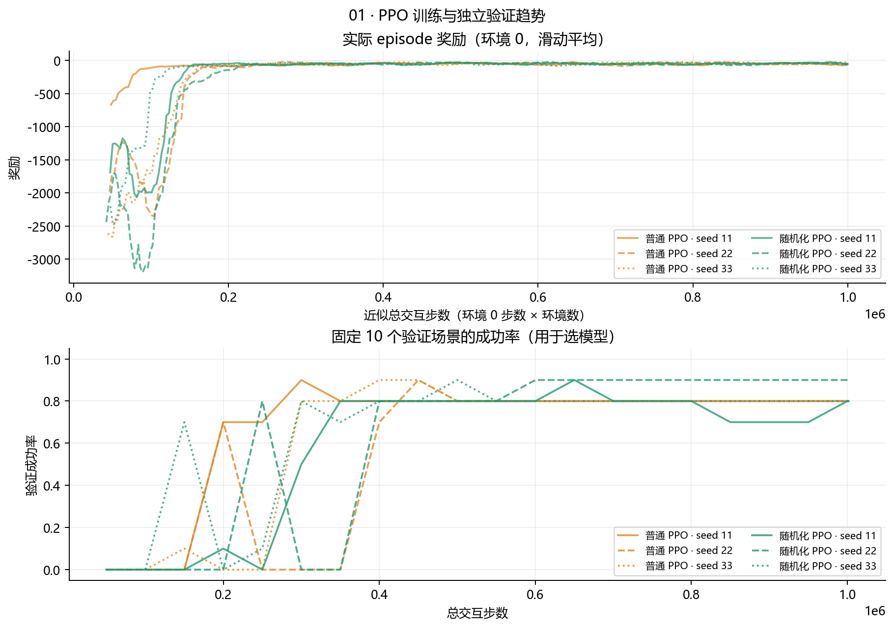
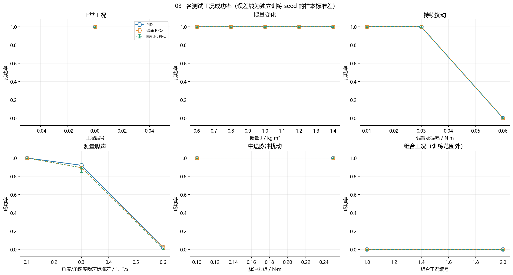
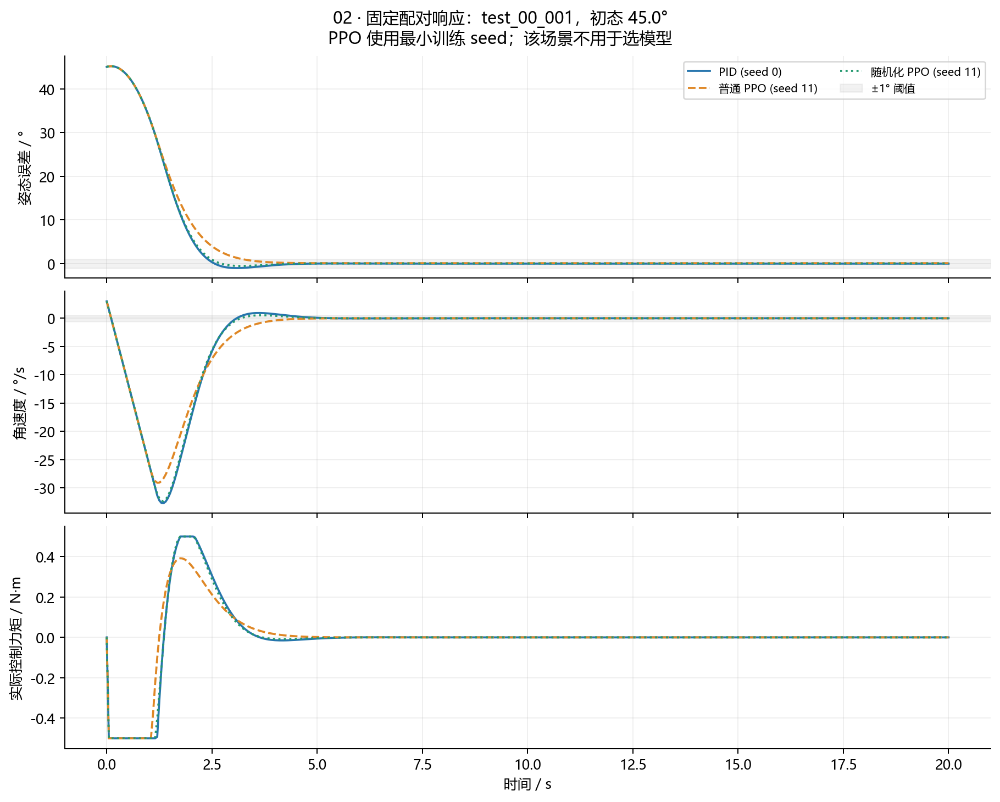

# 第三步：条件变复杂后，PPO能否做得更好

第二步说明理想单轴系统能控制好。这一步把问题往实际推进：**当卫星更难转、一直受到小力矩干扰，或传感器读数有抖动时，PID和学习出来的PPO分别会怎样？**

## 1．先分清三种“影响”

惯量变化相当于同样用力却更难或更容易转动；外部扰动是卫星另外受到一个真实力矩；观测噪声是实际状态未变，但传感器给出的读数在抖动。三者作用的位置不同，代码必须分别处理。

我们保留第二步的动力学和力矩限制，增加恒偏、正弦和中途脉冲扰动，以及角度/角速度的高斯测量噪声。指标使用真实状态计算，控制器只读取带噪的角度误差和角速度，避免让某个方法偷看真实惯量或真实扰动。

## 2．PPO是怎样学控制的

PPO是本阶段选用的一种强化学习算法。每一步，网络看到两个数：“当前偏了多少”和“正在转多快”；它输出一个−1到1之间的动作，环境将其乘以0.5 N·m，得到力矩。随后环境更新运动，给出奖励，算法据此调整网络参数。

奖励为`−(6e²+0.6ω²+0.03u²)`，e用rad、ω用rad/s、u用N·m。因此方向偏得大、转得快、力矩大都会扣分；这些权重属于本项目设计，并非物理定律。发散还额外扣分，避免策略靠提前结束躲掉后续代价。

奖励与“最后5秒每个采样点都停稳”的验收标准并不完全相同。因此训练奖励变好，不代表成功率必然提高。当前策略没有历史记忆或惯量估计模块，也不能因为训练时见过不同惯量，就说它已经学会在线辨识。

## 3．为什么训练普通与随机化两组

普通PPO在固定J=1、无扰动噪声的条件训练。随机化PPO在每回合开始随机设置J∈[0.7,1.3]、恒偏扰动∈[−0.02,0.02] N·m、测量噪声标准差∈[0,0.15]°或°/秒，并包含振幅0.02 N·m、频率0.2 Hz的正弦扰动。

直观设想是：训练时多见一些变化，测试时可能更不怕变化。但这只是待验证的假设。**本阶段同时改变了惯量、扰动、噪声；它不是第六步“只改变惯量”的受控研究。**

两组各使用11、22、33三个独立训练种子，网络和奖励一致。每份请求100万交互步，按完整采样批次实际执行1001472步，六份共6008832步。每隔约5万步在10个固定验证场景上检查，只用验证集选`best_model.zip`，不保证最后一步的模型最好。旧20万步探索不纳入这里的正式结果。

上图奖励整体上升，表示训练确实学到了控制；下图验证成功率仍有波动，显示“奖励已经很好看”与“所有要求都完成”是两回事。上下两幅横轴含义也不同：上幅是环境0日志推算的近似总步数，下幅是验证记录的总交互步数。

## 4．正式怎么比较

测试包含6类、16个具体工况，每个工况50个初态，共800场景。每个场景分别交给1个PID和6个PPO模型，所以是5600回合。相同场景复用初态、噪声设置与随机种子，不能把5600回合说成5600份独立训练。

训练、验证、测试分开；不过部分测试工况类型和等级在验证中出现过，独立主要指初态样本和噪声种子未参与选模。`outside_training_range`只相对随机化PPO训练范围定义，不能解释成所有算法从未见过这种问题。

## 5．真实结果说明了什么

| 工况类别 | PID成功率 | 普通PPO成功率 | 随机化PPO成功率 |
|---|---:|---:|---:|
| 正常 | 100% | 100% | 100% |
| 惯量变化 | 100% | 100% | 100% |
| 持续扰动 | 66.7% | 66.7% | 66.7% |
| 测量噪声 | 64.7% | 63.8% | 63.3% |
| 中途脉冲 | 100% | 100% | 100% |
| 组合压力条件 | 0% | 0% | 0% |

本表从[family_summary.json](支撑代码与数据/统计与场景/family_summary.json)取数。PPO为三个种子的合并描述，各种子均被保留。组合0%表示没有满足持续停稳判据，不表示卫星全部发散。

正常工况中，普通PPO稳定时间平均3.19秒，PID为3.37秒；平均控制代价分别0.3111、0.3432，普通PPO约低9.4%。但PID末段误差更小，随机化PPO没有提高成功率，还付出了名义精度代价。这里只能作有限数据的描述性比较，不能声称统计显著或实际省电9.4%。

图中大部分曲线重合。高持续扰动等级和强噪声下，三种方法都会失败；组合工况也全未达标。噪声图的误差线是三个训练种子的标准差，PID没有训练种子误差线。

配对图只展示`test_00_001`，PPO统一取最小训练种子11，用于理解动作差异，不能替代上述全部统计。对应三条原轨迹已保留。

## 6．为什么还要继续下一步

这一步证明了PPO能够学会控制，也显示复杂训练不自动带来鲁棒性提升。还不能据此判断“强化学习整体不行”，因为这里只比较了PPO和单轴系统。因此下一步扩展到三轴，并在同一套条件下加入SAC、TD3，检查算法差异和部署问题。继续读[第四步](../04_三轴扩展与多算法公平比较/本步讲解.md)。

本阶段精简保存六份选中模型、选模记录、逐回合指标、完整场景和三条固定演示轨迹；没有把5600条原始轨迹全部重复复制。详见[支撑材料说明](支撑代码与数据/阅读说明.md)。
