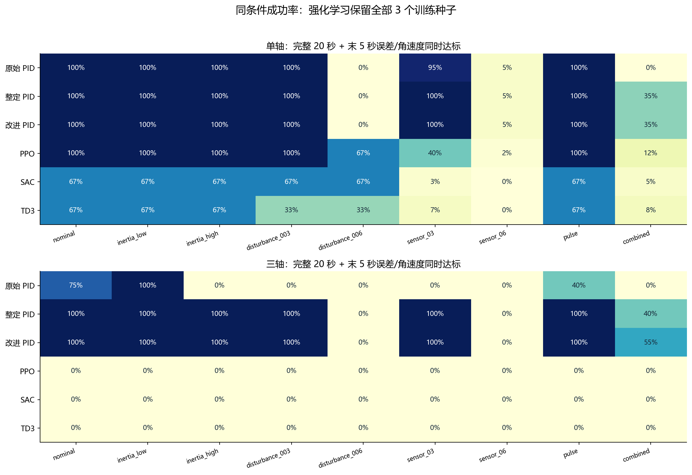

# 第04步：把单轴扩展为三轴，让不同算法接受同一场考试

**这一步要回答：前面在一个方向上能控制，扩展到真实空间中的三个转动方向后，PID和强化学习各自表现怎样？** 本步对应成果包中的第二版统一比较，简称V2；后面第06步的惯量专项研究另有训练和测试条件，数字不能混用。

## 1．为什么不能把三个单轴程序简单拼起来

单轴相当于卫星只能绕一根轴转；三轴允许它向空间中的任意方向转。三轴转动之间存在联系：当卫星同时绕几个方向转动时，一个方向的运动会影响其他方向。这叫“耦合”。本步保留了这种刚体耦合，动力学写成：

`I·ω̇ = τ + d − ω×(Iω)`

I是惯量矩阵，本模型的对角元素是三个主方向的转动惯量；ω是三个方向的角速度，τ是控制力矩，d是外部扰动力矩。最后一项描述三轴之间的转动影响。你需要理解的是：**同样的控制指令，结果还与卫星当前如何转动有关。** 三轴模型是理想刚体，尚未建立真实飞轮、柔性帆板或在轨环境。

三轴姿态用“四元数”记录。它是表示空间朝向的四个数，不是多出第四个转动方向；它能避开欧拉角在某些朝向下的表示问题。程序每步用RK4数值积分更新姿态，并将四元数归一化。控制器实际接收的是“往哪个方向转多少才能到目标”的三个数，加上三个角速度，共六维观测，不直接把四元数四个数作为控制误差。代码还处理了q和−q表示同一姿态的问题，避免仅因表示符号不同就下相反指令。

对应实现见[环境与四元数代码](支撑代码与数据/代码/multi_algorithm_benchmark/envs.py)。

## 2．四类方法分别在做什么

| 方法 | 先用一句话理解 | 本项目的实现特点 |
|---|---|---|
| PID | 偏了就拉回来，转得快就刹车，必要时累积长期偏差 | 人为确定反馈形式，在验证集选择参数 |
| PPO | 做一批尝试后小步修改控制策略 | 限制一次策略更新幅度，使用新采样轨迹学习 |
| SAC | 重复学习过去的经历，同时保留探索 | 使用经验回放、随机策略及熵项；正式控制时用确定性动作 |
| TD3 | 同样利用过去的经历，但谨慎更新动作策略 | 双价值估计、延迟策略更新；正式控制时关闭探索噪声 |

强化学习中的“策略”就是从观测到力矩指令的映射。奖励共同惩罚姿态误差、角速度和控制力矩平方，因此它们不只学习尽快到位，还在学习多种指标的取舍。相同奖励不保证三个算法一定学出相同效果，更不保证AI自动超过PID。

## 3．先把比较条件统一

旧材料中的模型来自不同训练条件，有些评价在首次进入角度阈值时就结束。这样会把“经过目标”误当成“在目标停稳”。本步因此从零训练新模型，并重新制定共同评价。

| 条件 | 单轴 | 三轴 |
|---|---:|---:|
| 标称惯量 | 1 kg·m² | diag(1.2,1.0,0.8) kg·m² |
| 仿真步长／时长 | 0.05 s／20 s | 0.02 s／20 s |
| 力矩限制 | ±0.5 N·m | 每轴±2 N·m |
| 控制器可见信息 | 测得的角误差、角速度 | 测得的三维修正误差、三维角速度 |

同一任务（单轴或三轴）内，各控制器使用相同初态、扰动和噪声实现；都不能读取真实惯量。PID内部能累积误差，当前神经网络使用瞬时观测，内部记忆并不相同。单轴与三轴物理条件不同，不能拿二者原始控制代价直接排名。

PPO、SAC、TD3各用三个训练种子11、22、33，分别代表三次独立训练。两种任务×三算法×三种子，共18份训练记录，每份请求100万交互步。PPO要收满一批轨迹，实际为1,001,472步；SAC、TD3为1,000,000步。**同交互预算不等于同计算量**，不同算法更新网络的方式和次数仍不同。

训练、验证、测试分开：训练用于学习；16个固定验证场景用于挑选模型和PID参数；最后测试用于报告结果，不反过来改参数。每轴20组初态在9工况间复用，共180条环境配置；RL每条配置测三个训练种子，PID每条测一次。9工况包括正常、低／高惯量、两档持续扰动、两档噪声、脉冲和组合压力。它们不是180个独立初态，部分工况类型也在验证中出现过。

## 4．怎样才算控制成功

20秒内不发散，并且**最后5秒的每一个采样点**都满足姿态误差≤1°、角速度≤0.5°/s，才算成功。三轴用误差和角速度的向量范数判断。只在最后一瞬间看起来很准，或绕目标来回摆动，都可能不成功。

先看成功率，再看误差和代价：末段平均误差小，不能替代整个末段始终达标；稳定时间只统计成功回合，成功率不同时不能直接据此宣布谁更快。控制代价`∫‖τ‖²dt`只是控制负担指标，没有测量电能。所有失败回合保留。

## 5．未经部署校准的真实结果

| 控制器 | 单轴成功率 | 三轴成功率 |
|---|---:|---:|
| 原始PID | 66.7% | 23.9% |
| 整定PID | 71.1% | 71.1% |
| 增加滤波候选的改进PID | 71.1% | 72.8% |
| PPO原策略 | 68.9% | 0.0% |
| SAC原策略 | 45.4% | 0.0% |
| TD3原策略 | 38.7% | 0.0% |

数据取自[完整逐回合CSV](支撑代码与数据/结果数据/episode_metrics.csv)。这里的0%表示没有一回合满足本步严格保持标准，**不等于所有回合都发生物理发散**，也不说明这些算法在一切卫星任务上都无效。后一步会检查神经策略的目标点动作偏置，校准后另列结果。

读图：上半图是单轴，下半图是三轴；每行一种控制器，每列一个工况。nominal是正常，inertia是惯量变化，disturbance是外扰，sensor是测量噪声，pulse是短时冲击，combined是组合压力。**从左到右看同一行，才能看到一种方法在哪些条件下失效。** 深色表示成功率高。本图是原策略结果，不包含后处理校准。

[三轴代表响应图](01_response_three.png)可帮助理解误差、转速、力矩如何变化；它只是一个示例，不能代替统计。[训练种子波动图](05_learning_seed_variation.png)说明同一算法换一次训练也会不同；误差棒是三种子样本标准差，不是置信区间。

## 6．这一阶段真正得到什么

这一步建立了能同时检查“转过去”和“停得住”的共同测试，并保留成功、失败和训练波动。测试结果显示，原始PID并非合理的最强基线；充分整定后，PID仍优于本步三种原始学习策略。下一步要继续问：**提升究竟来自参数整定、测量滤波，还是学习策略的部署处理？** 把这些作用分开，才能解释改进，而不是只展示一条漂亮曲线。

答辩表述见[答辩与论文用稿](答辩与论文用稿.md)；证据怎么查见[支撑材料说明](支撑代码与数据/材料说明.md)。
