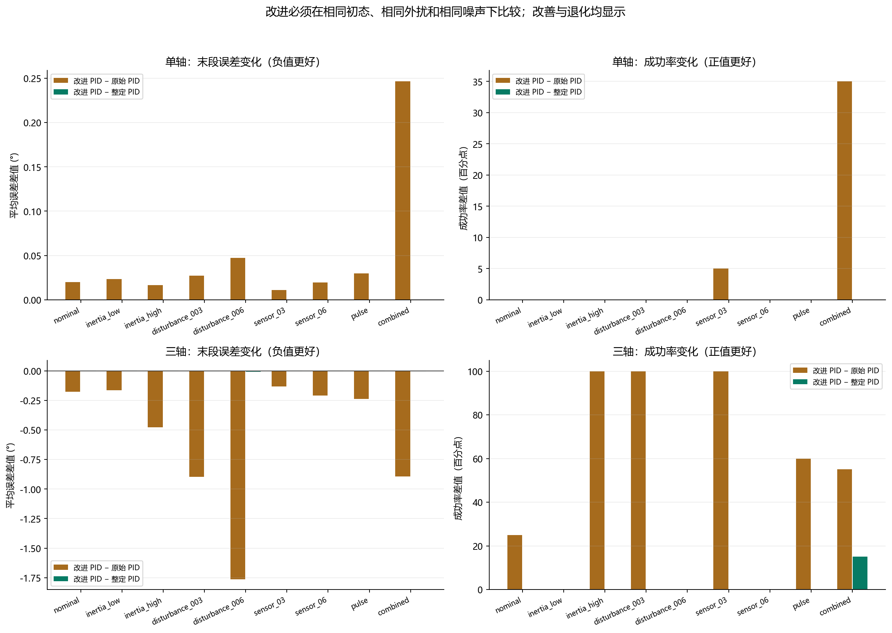

# 第05步：把“改进了”拆开，找出究竟改进在哪里

**这一步要回答：效果变好，究竟是PID参数调得更合适，还是滤波有效，还是神经网络输出的偏置被修正？** 三件事分别比较，才能说明工作价值。本步仍使用第04步V2的同一批正式测试；没有新训练，也没有把后面的惯量专项结果混进来。

## 1．先分清三种PID

“原始PID”是之前材料里的可追溯控制器，不代表充分调好的最佳PID。“整定PID”在验证集搜索参数；三轴还将误差差分导数改为直接利用测得的角速度作阻尼，程序也加入条件积分保护。“改进PID”在该基础上允许角速度低通滤波，并继续在验证集选参数。

直观上，比例项负责拉回目标，角速度阻尼负责刹车，积分项负责处理长期偏差。测量噪声会使瞬时读数跳动，滤波让刹车指令少跟着高频读数变化，但也可能带来滞后。执行器已达到力矩上限时，条件积分会拒绝进一步推高饱和的累积量，避免“明明已经用尽力气，内部指令仍越积越大”。

实际入选参数如下，详见[参数原件](支撑代码与数据/参数与验证/pid_configs.json)。

| 轴数 | 版本 | Kp / Ki / Kd | 滤波系数alpha |
|---|---|---|---:|
| 单轴 | 原始 | 4 / 0 / 3 | 1 |
| 单轴 | 整定、改进 | 2 / 0 / 5 | 1 |
| 三轴 | 原始 | 3 / 0.5 / 1 | 1 |
| 三轴 | 整定 | 4 / 0 / 6 | 1 |
| 三轴 | 改进 | 4 / 0 / 6 | 0.2 |

alpha=1等于不滤波；因此单轴改进版实际上与整定版相同。入选的整定、改进版Ki都为0，实际属于PD，**不能把它们的提升归功于积分抗饱和**。本步也没有把“换阻尼形式”和“换增益”分别消融，所以相对原始三轴PID的大幅提升只能归于整套整定方案，不能精确拆成各模块的功劳。普通整定搜索48组，扩展滤波搜索144组，后者搜索预算更大也需说明。

## 2．PID到底改善多少

| 指标 | 单轴：原始→整定→改进 | 三轴：原始→整定→改进 |
|---|---|---|
| 成功率 | 66.7%→71.1%→71.1% | 23.9%→71.1%→72.8% |
| 末5秒平均误差 | 0.145°→0.194°→0.194° | 0.724°→0.174°→0.173° |
| 平均控制代价 | 0.357→0.117→0.117 | 11.639→1.344→1.758 |

三轴从23.9%到72.8%，是提高48.9**个百分点**，不是48.9%的相对增幅。其中大部分提升在整定时已经出现；滤波方案相对整定PID只多成功3个场景，180场景中由128次到131次，即+1.7个百分点，同时平均控制代价增加约0.414。本测试中两版增益相同，差别体现在alpha，但没有证明滤波在其他任务也必然有效。

单轴成功率提升，但末段平均误差和全程RMS都增加，控制代价降低。说明方法可能更稳妥、更少用力，却不一定每个指标都更好。

读图：棕色比较改进版和原始版，绿色比较改进版和整定版。左列是末段误差差值，负值更好；右列是成功率差值，正值更好。单轴左上棕色为正，正好提醒我们不能宣传“全部误差都降低”。各柱来自相同场景配对，完整依据在[PID配对CSV](支撑代码与数据/结果数据/paired_improvements.csv)。

## 3．强化学习还有一个部署问题：到目标后仍然用力

假设卫星已经对准目标、角速度也为0，给网络的观测就是全0。理想的标称静止控制应输出0力矩，但神经网络可能仍输出一个常数动作。相当于车已停好，控制器却还轻踩着油门，最终会留下偏差。

本步对每份模型预先计算零观测动作a₀，部署时使用：

`校准动作 = clip(原动作 − a₀, −1, 1)`

例如零观测时输出0.03，之后每次都减0.03，再按原力矩边界限幅。**这叫零动作校准，是同一网络的输出后处理；没有修改网络权重，不是新训练算法。** 它不测量惯量、不读取真实状态，也不是持续外扰估计器。在有恒定外扰时，减掉偏置可能削弱原有补偿，所以必须允许退化。

全部18个模型先在原验证场景中保留原／校准对照，然后所有版本共同进入正式测试。配对条件包括同一轴、算法、训练种子和环境场景；没有拿不同种子的好坏结果互配。[校准代码](支撑代码与数据/关键代码/improvements.py)与[验证清单](支撑代码与数据/参数与验证/policy_calibration_manifest.json)均可直接查看。

## 4．同一个模型，校准前后发生什么

| 轴数／算法 | 成功率：原→校准 | 末段平均误差：原→校准 |
|---|---|---|
| 单轴PPO | 68.9%→68.9% | 0.293°→0.091° |
| 单轴SAC | 45.4%→68.5% | 0.579°→0.068° |
| 单轴TD3 | 38.7%→64.1% | 0.932°→0.138° |
| 三轴PPO | 0.0%→55.9% | 1.518°→0.215° |
| 三轴SAC | 0.0%→63.0% | 3.055°→0.085° |
| 三轴TD3 | 0.0%→24.8% | 8.716°→3.921° |

读图：灰柱是原策略，绿柱是校准策略；上半单轴，下半三轴。左边看成功率，右边看末段平均误差。误差棒是三个训练种子的标准差，图中向负值延伸不表示出现了负的物理误差；右侧有特殊刻度，读数应以表格为准。三轴SAC挽回340个成功回合，来自540组逐一配对；完整[校准配对CSV](支撑代码与数据/结果数据/policy_calibration_pairs.csv)保存了成功、失败和各指标变化。

校准并未让所有指标都改善：例如单轴SAC全程RMS由6.888°升到7.014°。校准后的三轴PPO／SAC／TD3成功率也都低于改进PID的72.8%。末段平均误差更小，不代表整个末段每时刻都达标，更不能替代成功率。

## 5．为什么后面选SAC，而不是宣布SAC最好

后续需要选一个学习算法深入研究。三轴是项目的核心扩展；本批校准RL中SAC的三轴成功率最高，末段误差也较低，因此选择SAC作为惯量专项的研究对象是有依据的。可是单轴最高成功率来自PPO，PID三轴成功率仍更高，所以不能写“SAC全面优于PID”，也不能写“SAC是普遍最好的AI”。

这一阶段的价值是发现并检验了部署偏置问题，建立了可核查的改进对照。下一步进一步缩小问题：**固定采用SAC，专门检验改变训练中的惯量范围，能否让它在未知惯量下无需重新调参。** 这是第06步的新研究问题，其条件、数据和结论单独报告。

答辩表达见[答辩与论文用稿](答辩与论文用稿.md)，复核方法见[材料说明](支撑代码与数据/材料说明.md)。
