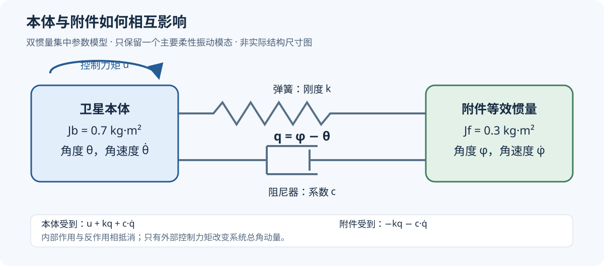

# 第05步：把柔性附件加入卫星姿态模型

前面的刚体姿态模型回答“卫星怎样转到目标方向”。本步再考虑一个实际现象：**本体在加速和刹车时，会使较柔软的帆板或天线振动；附件振动又反过来影响本体。** 所以，新的任务不仅要求本体到位，还要求附件一起停稳。

这里使用双惯量、线性扭转弹簧和黏性阻尼器构成的等效模型。它保留一个主要柔性振动模态，适合先研究控制规律；参数不是某颗实物卫星的辨识结果，也没有建立帆板有限元模型。

## 1. 先看清模型中的三个角度



| 符号 | 意义 | 单位 |
|---|---|---|
| θ | 本体相对目标方向的转角 | rad |
| φ | 附件的等效转角，与θ相对同一参考方向测量 | rad |
| q＝φ−θ | 附件相对本体的变形角 | rad |
| Jb、Jf | 本体和附件的等效转动惯量 | kg·m² |
| u | 只施加在本体上的控制力矩 | N·m |
| k | 本体与附件之间的扭转刚度 | N·m/rad |
| c | 本体与附件之间的黏性阻尼系数 | N·m·s/rad |

例如，本体转到10°而附件暂时只转到9°，则q＝−1°，说明附件落后于本体。若两者都转到10°，则q＝0：系统虽然整体转了一个角度，附件却没有相对变形。

φ只是集中参数模型中的等效角度。真实帆板会沿长度方向弯曲，不能把φ解释成“整块帆板始终作为刚板一起转动”。

## 2. 方程怎样从力学定律得到

科学依据是固定轴转动的角动量定律，加上线性弹性和黏性阻尼关系。

相对变形为q时，弹性力矩与q成正比；相对运动速度为q̇时，阻尼力矩与q̇成正比。对附件而言，这两种力矩都阻止相对变形继续增大，因此附件受到：

```text
附件所受内部力矩 = −kq − c·q̇
```

根据作用与反作用，本体受到相反的内部力矩。再加上外部控制力矩u，得到：

```text
Jb·θ̈ = u + kq + c·q̇
Jf·φ̈ =   − kq − c·q̇
```

这里没有给附件另装一台控制器，控制器只能直接推动本体。

用q＝φ−θ，两条方程可改写成代码实际使用的形式：

```text
θ̈ = u/Jb + (kq + c·q̇)/Jb
q̈ = −u/Jb − (1/Jb + 1/Jf)·(kq + c·q̇)
```

负号很重要：如果u刚开始向正方向推动本体，附件来不及跟上，q就会向负方向变化。弹簧随后把附件带起来，同时对本体产生反作用。

## 3. 为什么这确实是振动模型

在u＝0时，第二条方程就是标准二阶阻尼振动方程：

```text
q̈ + 2ζωn·q̇ + ωn²·q = 0
```

其中ωn是无阻尼固有角频率，ζ是无量纲阻尼比。将系数与力学方程对应：

```text
ωn = 2πf
μ = Jb·Jf/(Jb + Jf)
k = μ·ωn²
c = 2μ·ζ·ωn
```

μ称为约化惯量。本研究Jb＝0.7、Jf＝0.3，因此μ＝0.21 kg·m²。例如f＝0.6 Hz、ζ＝0.025时，k约为2.985 N·m/rad，c约为0.03958 N·m·s/rad。

需要区分三个概念：

- f是本体与附件均能运动时的相对振动固有频率；不能用“把本体固定”的频率公式直接代替。
- ζ是阻尼比，c才是有单位的阻尼系数。
- 本体和附件能作为整体自由转动，因而还存在不改变q的刚体运动；整个系统并不是只有一个被弹簧固定在地面的振子。

## 4. 用能量和角动量检查模型是否合理

两条物理方程相加，内部力矩抵消：

```text
d(Jb·θ̇ + Jf·φ̇)/dt = u
```

这说明内部弹簧和阻尼不能凭空改变系统总角动量。控制力矩为零时，总角动量守恒。

系统机械能为：

```text
E = ½Jb·θ̇² + ½Jf·φ̇² + ½k·q²
dE/dt = u·θ̇ − c·q̇²
```

第一项是执行器输入功率，第二项表示阻尼耗散能量。没有控制输入时，阻尼只会消耗机械能，弹簧不会凭空制造能量。这是模型符号和物理意义的一项检查。

注意：这里的机械能关系用于解释模型，不能把实验中的“力矩平方积分”称为实测耗电量。

## 5. 控制器和程序使用哪几个状态

程序状态为x＝[θ，θ̇，q，q̇]。分别把四个分量写作x₁至x₄，两条二阶方程因此成为四条一阶方程：

```text
ẋ₁ = x₂
ẋ₂ = (k/Jb)x₃ + (c/Jb)x₄ + u/Jb
ẋ₃ = x₄
ẋ₄ = −ωn²x₃ − 2ζωnx₄ − u/Jb
```

第一行和第三行是“角度的变化率等于角速度”，并非额外的物理假设。论文使用的矩阵形式和解析离散方法见本步《答辩与论文用稿》。

仿真每0.05 s更新一次控制命令，并假定这0.05 s内力矩恒定，称为零阶保持。原程序利用刚体与振动坐标分离进行解析推进；独立核验则使用原物理状态方程的矩阵指数重建，检查两个不同实现得到的轨迹是否一致。

## 6. 所有方法必须完成同一个任务

| 项目 | 本研究设定 |
|---|---|
| 本体、附件惯量 | 0.7、0.3 kg·m² |
| 初始本体角度 | 在−30°至30°之间变化 |
| 初始本体角速度 | 在−2°/s至2°/s之间变化 |
| 初始附件状态 | q＝0、q̇＝0，即起点没有相对振动 |
| 柔性频率 | 训练时在0.4～0.8 Hz内随机变化 |
| 阻尼比 | 在0.01～0.04内随机变化 |
| 随机参数的变化时机 | 每回合重新抽取，回合内不变 |
| 控制力矩上限 | ±0.5 N·m |
| 控制间隔、回合长度 | 0.05 s、22 s，共440次控制 |

训练中连续抽取频率；正式主测试在0.4、0.5、0.6、0.7、0.8 Hz五个频率上，配合独立初态和阻尼进行。**这是训练范围内的参数变化测试，不能称为训练范围外泛化。**

从8 s起直到22 s，每一个采样点都要同时满足：

- |θ|≤1°、|θ̇|≤0.5°/s：本体到位并保持。
- |q|≤0.1°、|q̇|≤0.5°/s：附件相对振动也受到抑制。
- 整回合没有触发模型适用范围越界等失败。

程序把|q|＞10°、|θ|＞170°或|θ̇|＞300°/s记作失败。这是仿真的适用范围与运行保护规则，不是实物损坏标准。超界后状态冻结、输出置零，但计时仍走到22 s，并持续计入失败惩罚；不能靠提早结束来获得较小代价。

仅本体角度到位，或某一个时刻短暂通过阈值，都不算完成任务。这里核对的是采样点，没有给出采样点之间连续时间约束的严格保证。

## 7. 本步模型能说明什么，不能说明什么

这个模型能研究“本体运动怎样激发一个主要柔性振动，以及反馈怎样抑制它”。它具有明确力学来源，四个状态也能分别对应本体运动和相对振动。

它仍是单轴、单柔性模态、理想力矩源的近似；原主实验没有测量噪声，第07步另行说明带小初始振动和假设测量噪声的补充验证。假设本体和附件的四个状态都可测；具体需要角度传感器、应变或振动测量以及状态估计，当前仿真没有解决这些硬件问题。模型没有使用具体卫星的材料、尺寸、有限元模态或试验数据，所以不能写成“已经验证某型号卫星帆板”。

前面的刚体三轴研究可以作为基础成果；**本步柔性单轴研究完成，不代表三轴柔性耦合研究也已完成。**

下一步研究的是：在同一个模型和同一套验收要求下，PID、输入整形、完整状态反馈与PPO补偿分别怎样输出力矩。

代码和设定来源见[支撑材料说明](支撑代码与数据/材料说明.md)。
