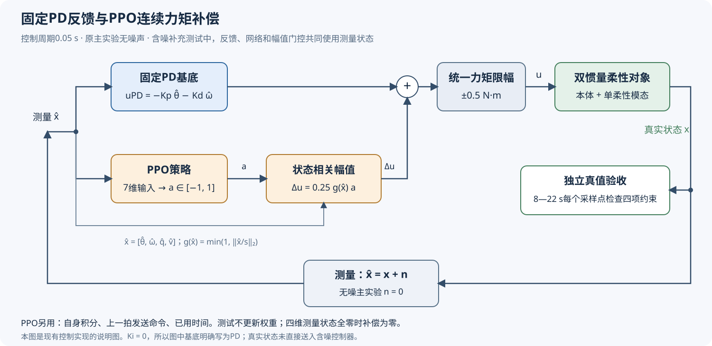
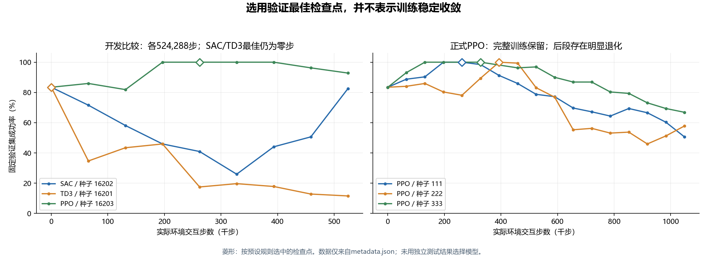

# 第06步：PID负责基本控制，PPO学习怎样补偿

本步先把控制方法讲清，再看实验结果。研究问题是：**在同一个柔性附件模型中，给固定PID增加连续力矩补偿，能否更可靠地同时实现本体到位和附件停稳？** PPO并不代替整个控制器，也不是只选顺时针或逆时针。



图中上支路是固定PD，下支路是PPO补偿，两者相加后统一限幅。底部回路只把测量送给控制器；右侧验收支路使用真实状态。下文逐项解释这些信号。

## 1. PID怎样输出力矩

目标方向设为0，记θ̂为本体角度测量值、ω̂为本体角速度测量值，反馈误差e＝−θ̂。程序采用：

```text
u_PID = Kp·e − Kd·ω̂ + Ki·I
I ≈ 误差随时间的累积
```

比例项根据角度误差施力；微分项根据当前转速提供阻尼；积分项用于消除持续偏差。程序对积分设置上下限，并在输出饱和且积分会继续推向饱和方向时暂停积分，以减轻积分饱和。

学习补偿使用的固定基底参数为：Kp＝0.6424195424，Kd＝1.7217308003，Ki＝0。**它属于PID框架中积分项为零的PD控制，不能说这一组参数实际使用了积分作用。** 代码仍统一保留PID接口和积分状态，便于对照和复现。

这一组是按减少适用范围越界优先选出的较保守参数。它不是从所有PID中按任务完成率选出的最佳参数，所以实验还必须另列成功率优先整定的PID及追加整定结果，不能只对比这一个保守基底。

## 2. 神经网络究竟补偿什么

PPO网络每0.05 s输出一个实数a，送入控制器前限制在[−1,1]。最终命令为：

```text
g(x̂) = min(1, ||x̂/s||₂)
Δu = 0.25·g(x̂)·a
u = clip(u_PID + Δu, −0.5, 0.5)
```

其中控制器实际使用的是四维测量状态x̂＝[θ̂，ω̂，q̂，v̂]，依次为本体角度、角速度、附件相对变形及相对速度的测量值。归一化尺度s＝[30°，10°/s，1°，5°/s]，||·||₂表示把四个归一化量平方、相加、再开方。0.25的单位是N·m。

原主实验无测量噪声，所以x̂＝真实状态x。第07步的含噪补充组使用x̂＝x＋测量噪声；**PID反馈、PPO输入和补偿幅值g(x̂)都使用测量，动力学推进与验收才使用真实状态。** 没有让门控系数暗中读取无噪真值。

网络可以在正负两个方向连续加减力矩，补偿幅值最大0.25 N·m；叠加以后仍受总力矩±0.5 N·m限制。它能在本体运动将激发振动时调整施力，也能根据已有的相对振动改变动作。是否做到了这些，要通过轨迹与消融验证，不能仅凭神经网络存在就认定它已经学会。

为什么还乘g(x̂)？当四个测量状态都趋于零，g(x̂)也趋于零，补偿被强制减小；在四个测量状态全为零时，补偿严格为零。仅本体角度误差为零，而转速或附件振动不为零时，补偿仍然可以工作。含噪情况下，即使真实状态全为零，测量也可能不为零，因此仍可能输出小补偿。**这保证的是测量状态原点的零补偿，不能单独构成闭环稳定性证明。**

## 3. PPO看到了哪些信息

网络输入为7维：

| 维度 | 输入内容 | 归一化方式 |
|---|---|---|
| 1 | 本体角度测量误差−θ̂ | 除以30° |
| 2 | 本体角速度测量ω̂ | 除以10°/s |
| 3 | 附件相对变形测量q̂ | 除以1° |
| 4 | 附件相对速度测量v̂ | 除以5°/s |
| 5 | 控制器自身积分I | 除以积分尺度60°·s，代码以deg2rad(60)取数值 |
| 6 | 上一拍实际发送的命令 | 除以0.5 N·m |
| 7 | 已用时间占总回合的比例 | 当前步数除以440 |

所有内部物理计算使用弧度；表中的“除以30°”表示除以30°对应的弧度数值。积分I具有rad·s单位，固定积分尺度为π/3 rad·s，不能把它写成角度测量。

网络没有直接获得本回合真实频率、阻尼、刚度或“正确补偿力矩”。测试时模型权重固定，不在线更新；本方法没有循环网络和显式参数辨识器，因此也不应说它在测试中重新训练或直接识别出了参数。

## 4. 奖励怎样对应控制目标

训练奖励用于引导搜索，最终结论仍由第05步的独立验收规则决定。奖励主要惩罚五件事：本体偏离、转速、附件变形、相对速度、控制力矩。

使用归一化状态z＝[θ/30°，θ̇/(10°/s)，q/1°，q̇/(5°/s)]，基础代价为：

```text
L = 2z₁² + 0.05z₂² + 0.5z₃² + 0.05z₄² + 0.15(u/0.5)²
```

活跃状态每一拍的代价先将L截到不超过30；如果8 s以后仍有任何状态超出验收范围，再加10。奖励取该代价乘−0.05。触发模型越界等失败后，每一拍改为更大的固定惩罚−0.05×50，一直持续到22 s。

程序还加入基于状态势函数的奖励塑形，用相邻两拍的状态改善提供更密的学习信号。势函数是负的归一化状态代价，折扣率0.999，并在有限回合终点清零；精确公式见本步论文用稿。这个附加项帮助训练，并未改变正式测试的成功定义。

**失败不会提前结束回合。** 这样可以避免控制器通过越界提早退出，以较少累计力矩或较少受罚获得虚假的好成绩。

## 5. 为什么最后选PPO，而不是直接认定SAC最好

开发阶段在相同环境与同一基底上，分别训练SAC、TD3、PPO，各524,288个环境交互步。这里的“步”是与环境交互的次数，不是梯度更新次数。

| 算法 | 开发阶段保存的最佳步数 | 最佳验证完成率 | 该结果的含义 |
|---|---:|---:|---|
| SAC | 0 | 267/320 | 零步是未学习的原基底，没有得到更好的可选检查点 |
| TD3 | 0 | 267/320 | 同上，不能把它称作成功的学习模型 |
| PPO | 262,144 | 320/320 | 产生了非零步、无越界且通过门槛的学习候选 |

所以本次选择PPO进入正式训练。三种算法共享物理任务和步数预算，但具体超参数并不相同；开发各只有一个随机种子，也没有系统超参数搜索。因此它支持“本任务、本实现、本预算下选择PPO”，不支持“PPO普遍比SAC和TD3强”。

## 6. 正式模型如何选取，训练有哪些不稳定

PPO用111、222、333三个新随机种子分别从零训练，每个实际完成1,048,576步。随机种子只是控制随机数过程的编号，不是网络层数、模型版本或测试场景编号。

每65,536步在固定验证集上评估，训练开始前也评估零步基底。按“越界等失败少优先、成功数多优先、惩罚后的选择代价小优先、同分时较早步数优先”选最佳检查点。独立测试集不参与这一选择。

| 正式种子 | 实际训练步数 | 采用的最佳检查点 | 最佳验证成功数 | 训练终点验证成功数 |
|---|---:|---:|---:|---:|
| 111 | 1,048,576 | 262,144 | 320/320 | 162/320 |
| 222 | 1,048,576 | 393,216 | 320/320 | 185/320 |
| 333 | 1,048,576 | 327,680 | 320/320 | 214/320 |



图中所有点来自保留的metadata.json。三条正式曲线后段都下降，所以必须坦诚：**已获得可用的验证最佳模型，但没有证明持续训练会稳定收敛。** 正式测试用的是事先按验证规则保存的best.zip，而不是训练末尾的final.zip；两类文件都保留。

本次修正后的六次完整训练共4,718,592步。此前其他目录中的早期失败尝试保留，但不能把未完整记录的中断步数混入这个精确合计。

## 7. 怎样判断改善究竟来自哪里

比较分为几层，每一层回答不同问题：

| 比较 | 回答的问题 |
|---|---|
| 保守PID基底 vs 同一基底＋PPO | 加入学习补偿后，相对原基底是否有改善？ |
| 成功率优先整定PID及追加整定PID vs PPO组合 | 是否只是选了一个较弱的PID基底？ |
| ZVD输入整形＋PID vs PPO组合 | 传统的减少振动激励方法能做到什么程度？ |
| 使用同样四个状态的LQR vs PPO组合 | 完整状态的传统反馈是否同样有效？ |

各方法都可获得本体与柔性状态，PPO不额外得到真实参数。但“可以获得”不等于“结构会使用”：普通PID公式只利用本体误差和角速度，LQR和PPO则利用柔性状态。因此，**相对PID的收益不能全部归因于强化学习独有能力，也可能来自增加了柔性状态反馈。** 这正是保留LQR对照的原因。

本方法没有全局稳定性证明，没有由真实传感器标定的噪声模型和硬件试验。第07步负责回答实际成功率、控制代价和这些对照的结果，并区分原无噪主实验与假设噪声补充测试；不要只展示一条漂亮轨迹或一个随机种子。

代码、训练记录和图的生成脚本见[材料说明](支撑代码与数据/材料说明.md)。
