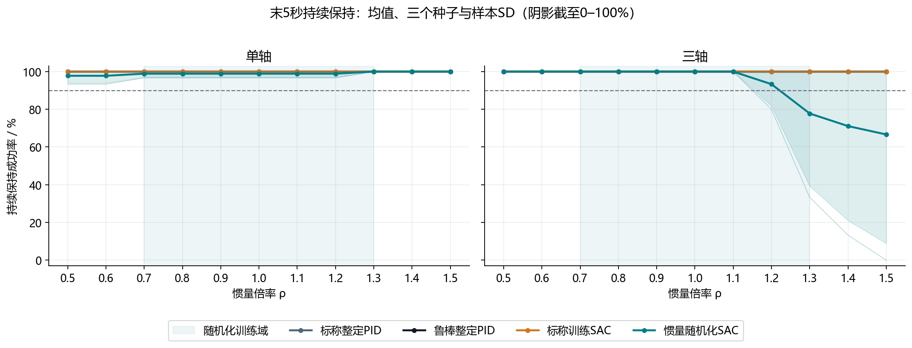
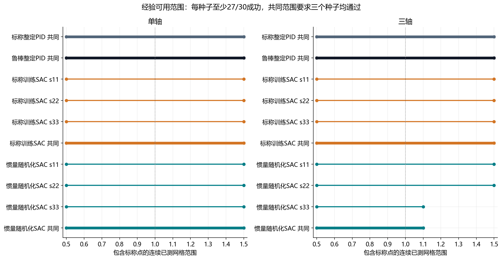
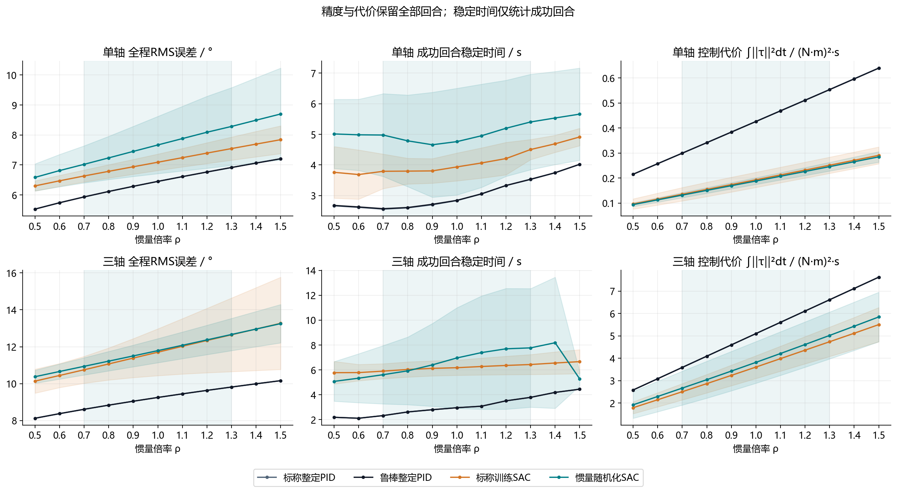
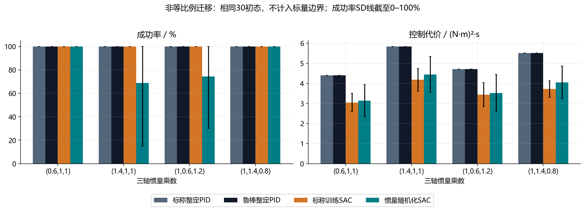

# 惯量域随机化与泛化边界研究分析

本轮是结项前最后一轮技术研究。三轴为主，单轴用于机制对照；采用从零训练的SAC，比较标称训练与仅惯量随机化，并与同预算充分整定的两类PID对照。下列结论来自预先冻结的测试，保留全部训练种子、原始动作消融和失败回合。

## 实测核心结论

单轴域外成功率由100.0%变为98.9%，随机化相对标称训练变化-1.1个百分点。三个种子共同可用网格由11个变为11个。

三轴域外成功率由100.0%变为84.4%，随机化相对标称训练变化-15.6个百分点。三个种子共同可用网格由11个变为7个。

域外仅指ρ=0.5、0.6、1.4、1.5；训练域端点0.7/1.3未算作域外。这里的变化是本次三个训练种子、每轴30组复用初态下的描述性结果，未作统计显著性或真实卫星可用性保证。

本次未观察到仅惯量随机化扩大免重整定范围。两轴充分整定PID和标称训练SAC均覆盖至已测0.5–1.5倍网格，因而只获得该有限范围内可用的证据，没有找到它们的真实失效边界。三轴随机化SAC的共同范围缩至0.5–1.1，说明平均表现不能掩盖较弱种子。固定PID在惯量变化后并未崩溃，不能用预设叙事替代实测。

## 统一方法与冻结条件

单轴J₀=1 kg·m²，dt=0.05 s，力矩±0.5 N·m；三轴I₀=diag(1.2,1.0,0.8) kg·m²，dt=0.02 s，每轴力矩±2 N·m。两组SAC保持相同64×64网络、奖励、优化参数、初态和每份100万步预算，只改变每回合惯量为ρ=1或ρ∼U[0.7,1.3]。关闭外扰、脉冲与噪声，回合内惯量恒定。

每轴共同20场景域内验证集每10万步选模，以校准部署分数100×成功率−RMS−0.2×控制代价排名，平分按RMS、代价和较早检查点。两种训练模式均用共同域内验证，标称组虽不在随机惯量下训练，也利用域内验证选模。原始动作消融使用同一检查点。

固定部署校准为clip(π(o)−π(0),−1,1)。这是输出偏置后处理，不是新训练算法。权重、PID参数和偏置跨惯量冻结，模型不读真实惯量，也不含记忆或在线辨识，因此结论属于固定反馈策略的泛化和参数鲁棒性。

成功要求完整20 s的末5 s每个采样点同时满足真实姿态误差≤1°、角速度≤0.5°/s，三轴采用测地角和角速度范数。经验可用区间采用每点≥27/30成功、包含ρ=1的连续已测网格；SAC共同区间要求三个种子各自通过，未作网格间插值。

## 核心结果与两端差异

| 轴 | 控制器 | 标称成功率 | 域外成功率 | 域外末段均误差 / ° | 域外控制代价 | 共同经验区间 |
|---|---|---:|---:|---:|---:|---|
| 单轴 | 标称整定PID | 100.0% | 100.0% | 0.0000 | 0.4274 | 0.5–1.5，11个网格点（覆盖至已测范围） |
| 单轴 | 鲁棒整定PID | 100.0% | 100.0% | 0.0688 | 0.4270 | 0.5–1.5，11个网格点（覆盖至已测范围） |
| 单轴 | 标称训练SAC | 100.0% | 100.0% | 0.0000 | 0.1934 | 0.5–1.5，11个网格点（覆盖至已测范围） |
| 单轴 | 惯量随机化SAC | 98.9% | 98.9% | 0.0379 | 0.1890 | 0.5–1.5，11个网格点（覆盖至已测范围） |
| 三轴 | 标称整定PID | 100.0% | 100.0% | 0.0000 | 5.1044 | 0.5–1.5，11个网格点（覆盖至已测范围） |
| 三轴 | 鲁棒整定PID | 100.0% | 100.0% | 0.0000 | 5.1044 | 0.5–1.5，11个网格点（覆盖至已测范围） |
| 三轴 | 标称训练SAC | 100.0% | 100.0% | 0.0169 | 3.6412 | 0.5–1.5，11个网格点（覆盖至已测范围） |
| 三轴 | 惯量随机化SAC | 100.0% | 84.4% | 0.0555 | 3.8743 | 0.5–1.1，7个网格点 |

| 轴 | 控制器 | 低惯量端0.5/0.6成功率 | 高惯量端1.4/1.5成功率 | 最差种子域外成功率 | 域外种子SD |
|---|---|---:|---:|---:|---:|
| 单轴 | 标称整定PID | 100.0% | 100.0% | 100.0% | 不适用 |
| 单轴 | 鲁棒整定PID | 100.0% | 100.0% | 100.0% | 不适用 |
| 单轴 | 标称训练SAC | 100.0% | 100.0% | 100.0% | 0.0% |
| 单轴 | 惯量随机化SAC | 97.8% | 100.0% | 96.7% | 1.9% |
| 三轴 | 标称整定PID | 100.0% | 100.0% | 100.0% | 不适用 |
| 三轴 | 鲁棒整定PID | 100.0% | 100.0% | 100.0% | 不适用 |
| 三轴 | 标称训练SAC | 100.0% | 100.0% | 100.0% | 0.0% |
| 三轴 | 惯量随机化SAC | 100.0% | 68.9% | 53.3% | 26.9% |

SD为三个训练种子成功率的样本标准差，不是置信区间。PID是单个固定控制器，未报告虚构的训练种子波动。

aggregate_results.json中的nominal单列ρ=1，in_domain标签对应域内其余六个网格点；二者合并才是完整域内汇总。下表及核心结论的域外统计始终只含四个严格保留点。

## 控制代价收益与保持失败

单轴域外测试中，校准后的标称训练SAC与PID-N均为100%成功；SAC平均控制代价相对PID-N降低54.7%，成功回合平均稳定时间由3.26 s变为4.26 s，全程RMS由6.38°变为7.08°。较低力矩平方积分伴随较慢响应及较大全程误差，是条件性取舍，不等于省电实测或全指标改善。

三轴域外测试中，校准后的标称训练SAC与PID-N均为100%成功；SAC平均控制代价相对PID-N降低28.7%，成功回合平均稳定时间由3.23 s变为6.19 s，全程RMS由9.16°变为11.70°。较低力矩平方积分伴随较慢响应及较大全程误差，是条件性取舍，不等于省电实测或全指标改善。

以下对主控制器的全部标量测试失败按末段阈值直接分类：角度超限、角速度超限、两者超限或物理发散。它们属于验收失败，不都表示动力学发散。

| 轴 | 控制器 | 种子 | 角度超限 | 角速度超限 | 两者超限 | 物理发散 |
|---|---|---:|---:|---:|---:|---:|
| 单轴 | 惯量随机化SAC | 33 | 10 | 0 | 0 | 0 |
| 三轴 | 惯量随机化SAC | 33 | 0 | 82 | 0 | 0 |

三轴随机化组失败集中在种子33的角速度保持超限；该种子域内验证最高成功率为85%，低于其他种子的100%，但仍按预定规则保留。现有证据支持训练波动与高惯量端保持不足的描述，未通过额外因果实验确定具体优化机制。固定代表曲线使用预先约定的种子11，不能代表种子33或替代全体失败统计。

## 充分整定PID与训练交付

两类PID每轴各144个候选，合计576配置、11,520个域内验证回合。采用角速度阻尼、条件抗积分饱和和角速度滤波结构；标称/鲁棒仅整定惯量分布不同。Ki=0时是PID族的PD特例，alpha=1时不平滑观测。

| 轴 | 整定模式 | Kp | Ki | Kd | alpha |
|---|---|---:|---:|---:|---:|
| 单轴 | nominal | 8.0 | 0.0 | 5.0 | 1.0 |
| 单轴 | randomized | 8.0 | 0.08 | 5.0 | 1.0 |
| 三轴 | nominal | 8.0 | 0.0 | 4.0 | 1.0 |
| 三轴 | randomized | 8.0 | 0.0 | 4.0 | 1.0 |

| 轴 | SAC训练模式 | 种子 | 实际交互步数 | 选中步数 | 校准验证成功率 |
|---|---|---:|---:|---:|---:|
| 单轴 | nominal | 11 | 1,000,000 | 900,000 | 100.0% |
| 单轴 | nominal | 22 | 1,000,000 | 600,000 | 100.0% |
| 单轴 | nominal | 33 | 1,000,000 | 500,000 | 100.0% |
| 单轴 | randomized | 11 | 1,000,000 | 800,000 | 100.0% |
| 单轴 | randomized | 22 | 1,000,000 | 700,000 | 100.0% |
| 单轴 | randomized | 33 | 1,000,000 | 600,000 | 100.0% |
| 三轴 | nominal | 11 | 1,000,000 | 400,000 | 100.0% |
| 三轴 | nominal | 22 | 1,000,000 | 1,000,000 | 100.0% |
| 三轴 | nominal | 33 | 1,000,000 | 700,000 | 100.0% |
| 三轴 | randomized | 11 | 1,000,000 | 1,000,000 | 100.0% |
| 三轴 | randomized | 22 | 1,000,000 | 800,000 | 100.0% |
| 三轴 | randomized | 33 | 1,000,000 | 200,000 | 85.0% |

## 校准消融与非等比例迁移

| 轴 | 训练模式 | 原始域外成功率 | 校准域外成功率 |
|---|---|---:|---:|
| 单轴 | 标称训练SAC | 33.3% | 100.0% |
| 单轴 | 惯量随机化SAC | 0.0% | 98.9% |
| 三轴 | 标称训练SAC | 0.0% | 100.0% |
| 三轴 | 惯量随机化SAC | 0.0% | 84.4% |

校准可改善目标点的输出偏置，也可能损失部分回合或改变饱和区动作。全部配对损益在calibration_pairs.csv中，不能只报告恢复的成功回合。原始动作并非按其自身分数选出的最佳检查点，因此仅用于该部署规则的同检查点消融。

三轴四种非等比例乘数为(0.6,1,1)、(1.4,1,1)、(1,0.6,1.2)、(1,1.4,0.8)，对应主惯量满足正值与三角不等式。它们改变惯量比例和陀螺耦合，只是预先约定的迁移压力测试，不纳入标量泛化区间。

| 三轴控制器 | 非等比例成功率 | 最差种子成功率 | 全程RMS / ° | 控制代价 |
|---|---:|---:|---:|---:|
| 标称整定PID | 100.0% | 100.0% | 9.231 | 5.1179 |
| 鲁棒整定PID | 100.0% | 100.0% | 9.231 | 5.1179 |
| 标称训练SAC | 100.0% | 100.0% | 11.689 | 3.5941 |
| 惯量随机化SAC | 85.8% | 57.5% | 11.782 | 3.7888 |

## 五张核心图

### 成功率与惯量倍率

### 经验可用范围

### 精度速度与控制代价

### 非等比例惯量迁移

### 校准消融与固定代表轨迹

## 证据清单与解释限制

正式测试含330单轴场景与450三轴场景，每场景14个控制实例，总计10,920完整回合。正式模型12份、总交互12,000,000步；24个原始/校准动作实例不等于24份模型。配对表分别为4,680组训练分布比较、4,680组校准比较和780组PID比较。

[逐回合数据](../03_测试数据与配对结果/episode_metrics.csv)、[边界点](../03_测试数据与配对结果/boundary_points.csv)、[全部区间](../03_测试数据与配对结果/empirical_boundaries.csv)、[部署冻结](../03_测试数据与配对结果/deployment_freeze.json)、[实验清单](../03_测试数据与配对结果/evaluation_manifest.json)与全部NPZ互相对应。独立核验的实际状态请查看同目录核验报告，本文生成不代表核验自动通过。

控制代价为力矩平方积分，不是实测能耗；失败回合保留在误差和代价统计中，须结合失败率与有效时长。稳定时间仅对成功回合统计，成功样本变化会影响均值。跨倍率复用初态支持配对，不增加独立初态数量。

惯量变化在每个回合内恒定，不模拟燃料流出、帆板展开动力学或任意完整惯量张量。仿真未包含姿态估计、飞轮动量、柔性结构及实物验证。研究允许域随机化无收益或强PID更好，不以最终测试续训、改奖励或追踪更极端的边界。

本轮完成后冻结技术范围。后续只开展总结、两篇学习综述、结项报告、答辩和真实贡献核对；在线自适应、辨识、预测控制、STK与硬件留作未完成承诺或未来研究，据实解释。
