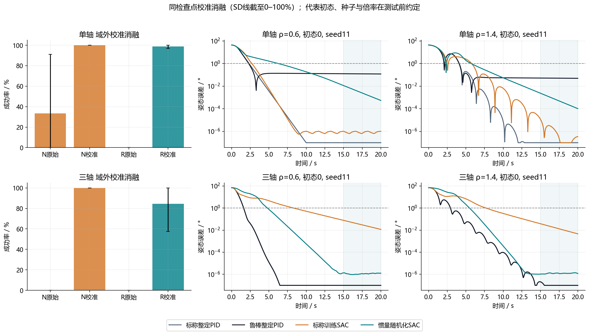

# 第六步：惯量变了，控制器还能直接用吗？

读完本步，你应能解释两个结果：为什么随机化训练的SAC没有胜过PID，以及为什么正常惯量训练的SAC虽然用力较少，却不能说全面更好。配套的[答辩与论文用稿](答辩与论文用稿.md)适合练习口头表达；[结果速查表](结果速查表.csv)便于核对数字。

## 1．为什么接着研究惯量

前面已经建立单轴、三轴模型，比较过PID与几种强化学习算法，并处理过网络输出偏置。本步把问题缩小：**训练完成后不再改参数，卫星惯量改变，原来的控制器还能不能把卫星转到目标方向并停稳？**

可以把惯量理解为“物体有多难转起来、又有多难停下来”。同样大的力矩，惯量越大，转速改变越慢。燃料状态、构型变化会改变惯量，这提供研究动机；本次只模拟每回合不同的固定惯量，没有模拟燃料流出或帆板展开过程。

先记住下列词语，再读实验：

| 词语 | 本步中的具体意思 |
|---|---|
| 标称惯量 | 设定的一套参考惯量，记为倍率ρ=1 |
| 惯量随机化 | 每回合开始时随机选ρ∈[0.7,1.3]，该回合内不再变化 |
| 域内 | 倍率位于[0.7,1.3]；包含边界0.7和1.3 |
| 域外 | 超出上述训练随机化范围；本次严格保留0.5、0.6、1.4、1.5四点 |
| 免重整定 | 从一种惯量换到另一种惯量，不重新调PID增益、网络权重或输出偏置 |
| 训练种子 | 控制训练随机性的编号；11、22、33对应三次独立训练，不是三个卫星轴 |
| 网格点 | 实际测过的惯量倍率；例如0.5、0.6、…、1.5，共11点 |
| 校准 | 事先减掉网络在零误差、零转速时的输出，测试中固定使用 |
| 控制代价 | 把每个时刻施加的力矩平方累加；是控制负担指标，未测电量 |

“域外”统一相对于随机化训练范围定义。标称SAC只在ρ=1训练，但也使用共同域内验证集选模型，不能说它完全没接触过其他惯量的验证反馈。

## 2．模型究竟改了什么

单轴动力学可写成 **J·角加速度=控制力矩**，这里J=ρJ₀；三轴写成 **I·角加速度＋ω×(Iω)=控制力矩**，其中I=ρI₀。三轴多出不同转动方向之间的耦合。

其中ω表示角速度，ρ表示相对正常值的倍数：ρ=1.5就是惯量增大50%。单轴J₀=1 kg·m²，每0.05秒更新、力矩限制±0.5 N·m；三轴I₀=diag(1.2,1.0,0.8) kg·m²，括号内是三个主方向的参考惯量，每0.02秒更新、每轴限制±2 N·m。两种训练都关闭外扰、噪声和脉冲，便于只考察惯量变化。

因此，V2校准三轴SAC的63.0%与V3标称校准SAC的100%，来自不同任务条件和不同模型，不能相减后说成功率提高了37个百分点。

网络只读取姿态误差和角速度，不读取真实惯量，也没有历史记忆和惯量估计模块。因此，这项研究检验的是**固定策略面对参数变化的泛化能力**。“免重整定”不能改称“已经实现在线自适应”。

## 3．怎样比较才公平

比较四组主控制器：标称惯量整定的PID-N、变化惯量整定的PID-R、标称训练SAC-N、随机化训练SAC-R。SAC名称未带raw时，均表示校准部署版本。

两种SAC采用相同64×64网络、奖励、优化设置和每份100万步预算，每轴各训练三个种子，共12份模型、1200万交互步；本轮均从零训练。每10万步在共同的20场景域内验证集检查一次，按预定规则选模型，正式测试不参与选择。两类PID各轴各搜索144组参数，合计576候选，避免只拿随手设的弱PID作比较。

每轴取30组测试初态，在11个倍率下复用，得到330个标量场景；三轴另有120个非等比例场景，共780场景。每场景运行2个PID与12个SAC实例：两种训练×三个种子×原始/校准动作。因此总计**10,920回合**；原始与校准共用模型，不能把12份模型说成24份。

每回合运行20秒。成功要求最后5秒的**每一个采样点**，角度误差≤1°且角速度≤0.5°/秒；三轴分别看整体姿态误差和角速度大小。经过目标附近一次，或只在最后一个时刻达标，都不算持续停稳。

## 4．先看可靠性：原来的设想没有得到支持

横轴是惯量倍率，纵轴是成功率，浅色背景标出随机化训练范围。先看右半幅三轴：随机化SAC在高惯量端明显下降，其他主控制器保持100%。阴影表示三个训练种子的波动，超出百分比范围的部分截断显示，不是置信区间。

| 域外结果 | 单轴成功回合/总回合 | 三轴成功回合/总回合 |
|---|---:|---:|
| PID-N | 120/120＝100% | 120/120＝100% |
| PID-R | 120/120＝100% | 120/120＝100% |
| 校准SAC-N | 360/360＝100% | 360/360＝100% |
| 校准SAC-R | 356/360＝98.9% | 304/360＝84.4% |

SAC总数更大，是因为每场景有三个训练种子。它们复用初态，不能当成360个独立初态。100%只表示本次有限测试全部通过。

三轴随机化组的失败集中在种子33；在全部330个标量场景中，它有82回合角速度保持超限，没有物理发散。其域内验证最高成功率已只有85%。所以不能简单归因于“域外太难”，也不能断言一定是训练步数不足。奖励、训练优化或观测结构的具体因果机制，尚未通过专门实验确定。

这张图进一步防止平均值掩盖弱种子：每个倍率至少27/30成功，再保留经过ρ=1的连续通过网格；SAC共同范围要求三个种子分别满足。三轴SAC-N覆盖11点，SAC-R共同范围只剩0.5—1.1的7点。横线连接离散点方便阅读，**没有证明点与点之间都稳定**。PID和SAC-N仍未在已测范围内失效，因此没有找到其真实边界。

## 5．再看取舍：用力较少，但动作更慢

每行从左到右分别看全程误差、稳定时间、控制代价，三个指标均越小越好。三轴随机化组右端稳定时间下降，不能直接解释为变快：稳定时间只统计成功回合，困难的失败回合退出了这个均值。

只比较域外测试中均全部成功的PID-N与校准SAC-N：

| 轴 | 方法 | 平均稳定时间 | 全程RMS误差 | 平均控制代价 |
|---|---|---:|---:|---:|
| 单轴 | PID-N → SAC-N | 3.26 → 4.26秒 | 6.38 → 7.08° | 0.4274 → 0.1934，降低54.7% |
| 三轴 | PID-N → SAC-N | 3.23 → 6.19秒 | 9.16 → 11.70° | 5.1044 → 3.6412，降低28.7% |

控制代价是 **C=∫‖τ(t)‖²dt**。一句话解释：SAC的动作比较轻，PID调整比较快。现有比较没有强制两者达到相同稳定时间，不能把代价下降当作同等性能下的优势，也不能写成省电54.7%或28.7%。

## 6．为什么必须交代校准

左侧比较同一个模型校准前后；三轴SAC-N域外成功率由0%变为100%，SAC-R由0%变为84.4%。零误差处仍输出力矩，会使平衡位置偏离目标。部署时采用 **动作=clip[π(当前观测)−π(零观测),−1,1]**，在零误差、零角速度的参考点确定输出偏置，并在正式测试前冻结。这是部署后处理，并非新强化学习算法；上述结果不能直接归给未经处理的原始SAC。原始动作使用按校准部署分数选中的同一模型，不代表为原始动作单独选出的最佳模型也只有0%。

这里π表示网络给出的动作，clip表示将动作限制在−1到1之间，再换算为允许的物理力矩。直白地说，就是先纠正“已经到位且不转动时，网络仍想推一下”的输出。

右侧轨迹在测试前已约定：种子11、初态0、倍率0.6和1.4。它们用于看过程，不能替代全体统计，尤其不能替代弱种子33。支撑层另附一个种子33失败样例：ρ=1.2、初态3，末5秒角速度曾达到0.645°/秒，超过0.5°/秒；即使结束时已降至0.129°/秒，仍不满足持续保持要求。这个解释用例是整理时提取的个例。

## 7．本步交付了什么，结论怎样表述

本步交付冻结协议、12份训练与验证记录、强PID搜索、完整逐回合指标、配对比较、经验范围及五张原科学图。此前独立核验复演了全部8,148,000个状态转移并重算动作和指标，通过意味着保存材料与实现一致；它不证明真实卫星物理模型正确。

可以说：**本次仅惯量随机化没有扩大免重整定范围；强PID具有良好参数鲁棒性；校准标称SAC体现较低控制代价与较慢响应之间的取舍。** 不可说“惯量变化PID就崩”“AI自动识别了惯量”或“AI全面超过PID”。

研究由此转向更具体的未来问题：是否能在保留反馈可靠性的同时，用在线估计或受限学习补偿减少代价？这些尚属后续设想，本次没有新增训练或完成验证。
