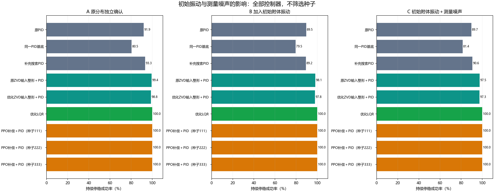
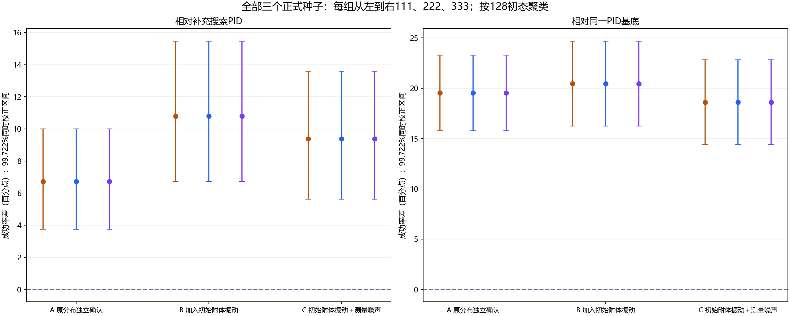

# 第07步：柔性附件对比实验与独立核验

## 先把问题说清楚

这一实验不只问“卫星朝向对不对”，还问“太阳帆板一类的附件有没有停稳”。只盯住本体角度的反馈，可能让本体停下而附件继续晃动；为了压住振动把增益调小，又可能赶不上规定时间。

我们检验：在已经固定的PID反馈上增加PPO连续力矩补偿，能否更经常在规定时间内同时完成本体对准与附件振动抑制。PPO每0.05秒输出一次补偿力矩，测试时不更新网络权重。

## 1. 统一验收，避免“慢慢来所以代价小”

每回合固定22秒、力矩限制±0.5 N·m。**从第8秒开始到第22秒结束，每个采样点都必须同时满足四项要求**：本体角误差≤1°、本体角速度≤0.5°/s、附件相对角度≤0.1°、附件相对角速度≤0.5°/s。不是只看最后一刻，也不是碰到目标就算成功。

控制代价是完整0—22秒的实际力矩平方积分。

\[
C_u=\int_0^{22}u(t)^2\,dt\approx0.05\sum_{k=0}^{439}u_k^2.
\]

它衡量力矩使用程度，单位N²·m²·s，不等于电池用电量。只有双方都完成任务时，才用较低代价支持效率优势；失败后不再施力造成的低积分不能当成节省。

## 2. 三组新测试如何设计

先冻结方案、源码、模型权重、传统控制参数和随机样本，再运行测试，不使用新测试挑模型。每组128个新初态，各自搭配0.4、0.5、0.6、0.7、0.8 Hz五种模态频率，形成640场景。九种控制器共享每组场景，共17,280回合。

|组别|本次新增的检查|要回答的问题|
|---|---|---|
|A 原分布确认|本体初角±30°、初转速±2°/s、阻尼比0.01—0.04；附件初始无相对振动|旧结果换一批新初态，优势还在不在？|
|B 初始小振动|相对初角均匀分布±0.05°、相对初转速±0.2°/s|附件不是静止出发，还能否完成？|
|C 初始小振动与噪声|在B类条件上，四状态测量加独立零均值高斯白噪声|读数有小幅误差时还能否完成？|

C组四项噪声标准差依次为0.01°、0.02°/s、0.005°、0.02°/s，所有方法使用同一场景的同一噪声实现。控制器只读取测量值；动力学和验收使用真实仿真状态。噪声是假定测试条件，未按实物传感器标定。

A/B/C的初态分别独立抽样。因此它们是三组分布下的表现检查，不能把组间差额完全解释为噪声或初振造成的因果变化。频率和阻尼在单回合内固定；这里没有验证训练频率范围外的泛化。

## 3. 为什么这些对照足够重要

同时保留三种PID参考：原成功率优先整定PID、与学习补偿完全相同的PID基底、补充搜索PID。前两者分别检查“是否只赢了保守参数”与“加网络后到底有没有增益”。补充搜索PID从3,825个历史开发候选中选择，旧测试上属于事后复核；这次A组是在参数事先冻结后进行的独立确认。

还比较ZVD输入整形与线性二次型调节器（LQR）。LQR和PPO都利用本体与附件的测量状态；普通PID的控制结构仅反馈本体误差。**信息可用范围一致不等于反馈结构相同，改善不能全部归因于强化学习训练。** LQR能检验：利用附件状态的传统控制是否也能解决问题。

各方法调参、训练与计算预算并不相等；这是固定设计的工程对照，不是证明算法最优性的比赛。

## 4. 新独立测试结果

### A：原分布全新样本

|方法|通过/640|越界回合|平均力矩平方积分（N²·m²·s）|残余相对角度RMS（°）|
|---|---:|---:|---:|---:|
|原成功率优先整定PID|588/640|27|0.125503|0.439077|
|学习补偿使用的同一PID基底|515/640|0|0.011584|0.012918|
|补充搜索PID|597/640|27|0.126755|0.437938|
|ZVD输入整形＋PID|636/640|0|0.008902|0.005777|
|优化ZVD输入整形＋PID|632/640|0|0.007527|0.006211|
|优化LQR|640/640|0|0.005526|0.004280|
|PID＋PPO（种子111）|640/640|0|0.009743|0.004980|
|PID＋PPO（种子222）|640/640|0|0.013875|0.005229|
|PID＋PPO（种子333）|640/640|0|0.007635|0.003351|

### B：增加初始小振动

|方法|通过/640|越界回合|平均力矩平方积分（N²·m²·s）|残余相对角度RMS（°）|
|---|---:|---:|---:|---:|
|原成功率优先整定PID|573/640|40|0.142345|0.645019|
|学习补偿使用的同一PID基底|509/640|0|0.012966|0.014030|
|补充搜索PID|571/640|40|0.143936|0.646770|
|ZVD输入整形＋PID|628/640|0|0.010094|0.006602|
|优化ZVD输入整形＋PID|626/640|0|0.008499|0.007058|
|优化LQR|640/640|0|0.006123|0.004532|
|PID＋PPO（种子111）|640/640|0|0.010850|0.005379|
|PID＋PPO（种子222）|640/640|0|0.015831|0.005630|
|PID＋PPO（种子333）|640/640|0|0.008317|0.003555|

### C：初始小振动与测量噪声

|方法|通过/640|越界回合|平均力矩平方积分（N²·m²·s）|残余相对角度RMS（°）|
|---|---:|---:|---:|---:|
|原成功率优先整定PID|574/640|35|0.133627|0.566121|
|学习补偿使用的同一PID基底|521/640|0|0.011939|0.013660|
|补充搜索PID|580/640|36|0.134988|0.582821|
|ZVD输入整形＋PID|624/640|0|0.009339|0.006929|
|优化ZVD输入整形＋PID|623/640|0|0.007857|0.007310|
|优化LQR|640/640|0|0.005636|0.004579|
|PID＋PPO（种子111）|640/640|0|0.010032|0.005700|
|PID＋PPO（种子222）|640/640|0|0.014650|0.005965|
|PID＋PPO（种子333）|640/640|0|0.007644|0.004183|

三个PPO模型在三组中各自均为640/640，均未出现模型范围越界。相对补充搜索PID，成功率分别提高6.719、10.781、9.375个百分点。相对同一PID基底，也均得到成功率改善。

“越界”指超出预设仿真范围；附件相对角度超过10°时，已不宜继续依赖此线性近似。它不等于实物帆板已损坏。

## 5. 不只看平均数：统计依据是什么

同一初态在五个频率上重复使用，这五个场景不能当成五个完全独立样本。统计按128个初态成组重采样，保留所有频率配对关系，执行200,000次bootstrap。

预先声明的主要比较有18项：三组×三个PPO种子×两个PID参照。Bonferroni校正后使用99.7222%双侧区间。三份模型相对两个PID参照的区间下界均大于0，三组主要优势检验均成立。下表三个种子的成功率相同，因此与补充搜索PID的区间也相同；它不意味着训练出的动作相同。

|测试组|PPO相对补充搜索PID的成功率差|99.7222%配对区间|
|---|---:|---:|
|A：原分布全新样本|6.719个百分点|[3.750, 10.000]个百分点|
|B：增加初始小振动|10.781个百分点|[6.719, 15.469]个百分点|
|C：初始小振动与测量噪声|9.375个百分点|[5.625, 13.594]个百分点|

代价与残余振动的108项次级比较另作一族校正，完整区间保存在内层材料索引。100%只描述本批样本，不能保证今后任何场景都成功。

## 6. PPO没有全面超过传统方法

优化LQR在三组也均640/640，而且完整时窗的力矩平方积分均低于三个PPO。PPO种子333的残余相对角度RMS低于LQR，但111、222不具备这一优势；不能挑333代表整个算法。

因此本实验支持：**PPO学习补偿相对所比较的PID提高了联合任务成功率，该结果在新样本、初始小振动和假定小测量噪声下得到确认。** 不支持“PPO优于所有传统方法”“不用模型必然更好”或“已解决真实卫星控制”。

## 7. 新测试与原有实验如何衔接

原柔性研究完成6份完整训练记录、4,718,592交互步；开发阶段比较SAC、TD3、PPO，再对PPO作三个正式种子训练。原主测试5,760回合，另有补充搜索PID复核640回合，共6,400回合。本次不训练新模型、不重新调参，新增17,280回合确认与条件检查。两批合计23,680回合柔性研究测试，不能称为23,680个独立初态。

这次补充的实际价值是把事后PID对照拿到新样本中确认，并检查轻度条件变化下结果是否保持；没有将旧的失败与中断训练改写为成功。

## 8. 怎么确认代码和结果可信

17,280回合全部7,603,200次状态转移，用从双惯量方程建立的独立状态空间矩阵指数核验；最大单步差约2.22×10⁻¹⁶，按记录指令整段重放最大差约1.56×10⁻¹⁴。测量值与真值加冻结噪声逐元素一致，策略动作复算差为0，验收、越界和代价另行重算。

物理核验与动作复算的范围要分清：这里独立建立了物理推进方法，但复用原策略实现复算PPO，不声称独立重写了PPO算法。代码核验通过也不等于获得真实硬件验证。

完整代码、冻结清单、27组轨迹、统计和核验记录均见[支撑材料说明](支撑代码与数据/材料说明.md)。接下来第08步把这些证据收束成论文结论。
