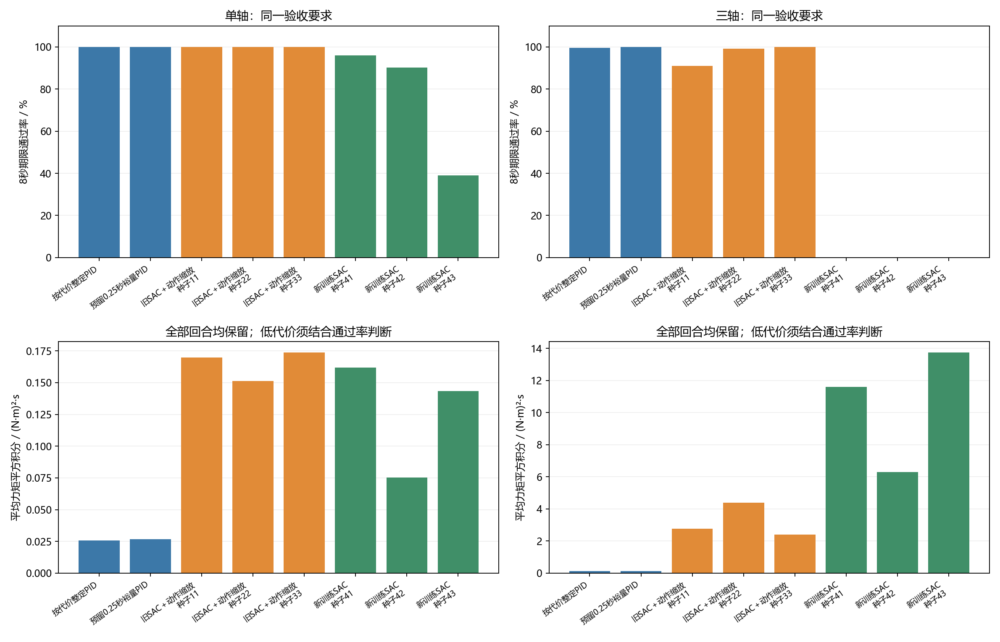
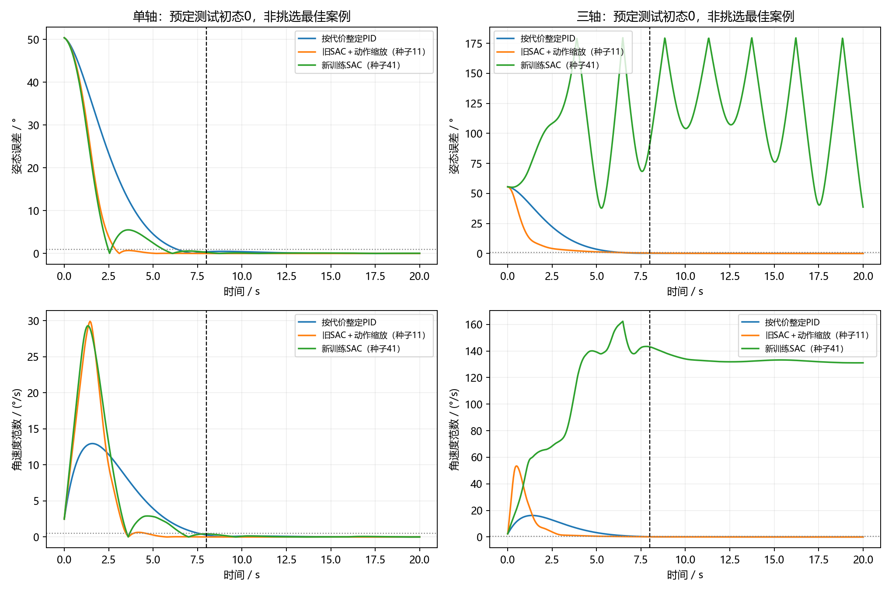

# 同等停稳要求下的控制代价比较：研究结果

本轮把问题改成：两种方法都必须按时停稳，然后比较完整20秒的力矩平方积分。它不是电能测量。原惯量研究的结论保持原有适用条件。

## 先看8秒期限的独立测试

每个控制器使用同一轴的256个全新初态。从第8秒到第20秒，每个采样点都要满足角误差≤1°、角速度≤0.5°/s。失败回合全部保留。

| 任务 | 控制器 | 通过 / 256 | 平均力矩平方积分 | 成功回合平均停稳时间 / s | 全程RMS / ° |
|---|---|---:|---:|---:|---:|
| 单轴 | 按代价整定PID | 256 | 0.025874 | 6.81 | 8.99 |
| 单轴 | 预留0.25秒裕量PID | 256 | 0.026745 | 6.66 | 8.92 |
| 三轴 | 按代价整定PID | 255 | 0.124704 | 7.16 | 15.69 |
| 三轴 | 预留0.25秒裕量PID | 256 | 0.134257 | 6.93 | 15.48 |
| 单轴 | 旧SAC＋动作缩放（种子11） | 256 | 0.169778 | 4.40 | 6.89 |
| 单轴 | 旧SAC＋动作缩放（种子22） | 256 | 0.151173 | 3.89 | 7.04 |
| 单轴 | 旧SAC＋动作缩放（种子33） | 256 | 0.173622 | 4.31 | 7.08 |
| 三轴 | 旧SAC＋动作缩放（种子11） | 233 | 2.767339 | 6.19 | 10.43 |
| 三轴 | 旧SAC＋动作缩放（种子22） | 254 | 4.391921 | 4.84 | 9.78 |
| 三轴 | 旧SAC＋动作缩放（种子33） | 256 | 2.401542 | 5.29 | 11.08 |
| 单轴 | 新训练SAC（种子41） | 246 | 0.161829 | 5.97 | 6.80 |
| 单轴 | 新训练SAC（种子42） | 231 | 0.075171 | 5.23 | 7.83 |
| 单轴 | 新训练SAC（种子43） | 100 | 0.143489 | 5.13 | 37.77 |
| 三轴 | 新训练SAC（种子41） | 0 | 11.607312 | 无通过回合 | 120.51 |
| 三轴 | 新训练SAC（种子42） | 0 | 6.290604 | 无通过回合 | 83.66 |
| 三轴 | 新训练SAC（种子43） | 0 | 13.736349 | 无通过回合 | 75.62 |

## 是否得到了强化学习更优的结论

**本轮8秒主要任务没有获得满足预定判据的强化学习控制代价优势。** 不能把更低的某个代价数值单独当成优越结论；双方可靠停稳、三个模型方向一致也是预先规定的条件。

- 单轴，旧SAC加验证选取的动作缩放：PID通过256/256，三个SAC模型分别通过256、256、256/256；平均代价相对PID增加537.2%；未达到本轮优势判据。
- 单轴，新训练SAC：PID通过256/256，三个SAC模型分别通过246、231、100/256；平均代价相对PID增加390.2%；未达到本轮优势判据。
- 三轴，旧SAC加验证选取的动作缩放：PID通过255/256，三个SAC模型分别通过233、254、256/256；平均代价相对PID增加2455.6%；未达到本轮优势判据。
- 三轴，新训练SAC：PID通过255/256，三个SAC模型分别通过0、0、0/256；平均代价相对PID增加8355.8%；未达到本轮优势判据。

## 为什么这次比较与旧结果不同

本轮最终选中的PID积分增益均为0，实际为PD控制；结果表沿用PID对照名称，不代表用到了积分作用。

旧PID选择偏重快速响应。本轮将低增益和逐轴增益纳入搜索，允许控制器利用规定的时间完成动作，再按代价选参。因此，旧研究中SAC代价较低，不能直接推出本轮也会更低。

同一验证集多次细化的参数可能贴近截止边界，在新初态上出现失败。本轮另在测试前保留预留0.25秒验证时间裕量的PID作辅助对照；该对照只从已有候选中选择，没有看测试再调参。主选择和辅助选择均完整报告。

新SAC在误差、角速度之外增加了时钟观测，并使用针对8秒任务的时变奖励；PID仍为固定增益结构。它们满足相同物理条件和验收要求，不是相同结构或完全相同输入处理的比较。若未来要判断学习是否必要，还应与轨迹规划、时变反馈或模型预测控制等比较。

训练奖励仍是包含误差和力矩项的软惩罚，并不是已经求解了带硬约束的最小力矩平方积分问题。开发只尝试两种奖励配置，正式采用固定预算。本轮未取得优势时，结论只限于这些具体训练与部署方案，不能推断强化学习在此类任务中永远不可能更好。

## 研究实际做了多少

新增正式训练为单轴、三轴各三个种子，共6份从零训练SAC、600万交互步；开发A/B各200k步、每轴两份，共4份开发记录和80万开发步，不混计为正式训练。已有6份SAC只调整部署动作缩放，不算新增训练。检查点、raw/calibrated部署实例均不算额外训练。

此外保留1次未完成训练尝试，实际交互100,000步，不计作完成模型；全部训练尝试合计实际交互6,900,000步。若因文件暂时占用而原种子重跑，恢复记录与未完成目录保留，不按结果好坏筛除。

正式独立测试包含39个控制实例、9984条评估记录（含物理失败后冻结并补齐时钟的记录），只有512个独立初态；多个控制器复用初态，不能把回合数当成独立初态数。

PID的开发广搜、验证筛选和局部细化都保留日志，后续重复评估含同一候选，不当作独立参数数量或正式测试回合。搜索到的是所考察候选中的结果，不是PID全局最优证明。

## 完整结果与统计限制

本轮全部评估记录中有1261条发生物理失败（不同控制器复用初态，按评估回合计数）。失败发生后状态冻结、后续力矩为0，时钟补齐到20秒；填充段不表示卫星仍在正常物理运动。首次失败所在区间的实际力矩仍计入代价。失败策略的低代价不能作性能优势。

4、6、8秒全部结果见[汇总CSV](全部控制器与期限汇总.csv)，逐条件配对结果见[比较JSON](配对比较与结论.json)。PID与旧SAC部署系数分别针对每一期限选择；新训练SAC只针对8秒优化，4/6秒结果是附加观察。

主判定要求指定PID和三个SAC模型均在测试中全部通过，三个模型代价差方向一致，且按初态配对自举的95%区间支持降低。区间保留同一初态的三个模型结果，只描述固定模型对初态抽样的不确定性，不充分覆盖训练随机性；没有对多期限作普遍显著性结论。

停稳时间只对相应期限通过的回合取均值，失败较多时不能拿这个均值直接说明更快。控制代价和RMS包含全部评估记录；如有物理失败，必须结合失败记录解释。

## 图怎么看

先看通过率，再看代价。未达到持续停稳要求的控制器，即使代价小，也不能按本轮规则认定更好。代表曲线固定使用初态编号0、旧种子11、新种子41，不是从结果中挑最好的一条。

## 复核入口

[独立核验报告](../06_核验/独立核验报告.json)须单独运行核验后生成；生成本文不等于核验通过。冻结记录约束模型、参数、代码和测试初态；最终测试后不续训、不改奖励、不重新选参。
