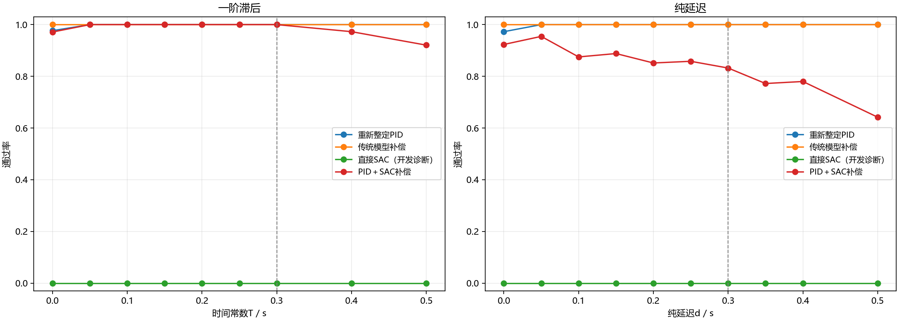
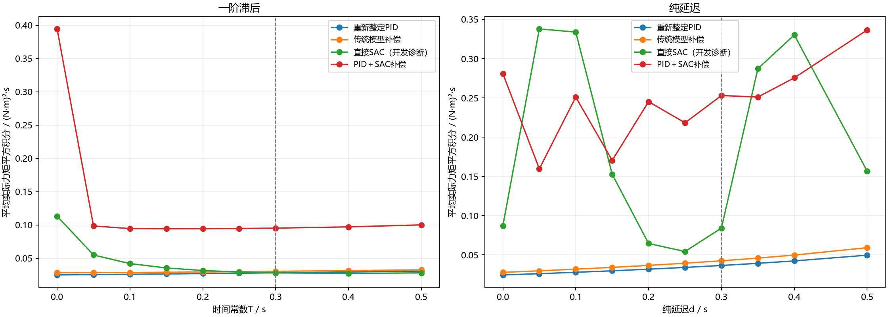

# 执行器一阶滞后与纯延迟：研究结果

本研究分别改变一阶滞后时间常数和纯延迟时间，在固定惯量、无外部扰动和准确测量下，比较固定PID、传统模型补偿、直接SAC和PID加SAC。真实执行器参数不向控制器公开。

已完成训练14份，其中正式训练6份；累计实际交互步4,200,000。独立测试产生29,184条回合记录，使用256个独立初态；同一初态在不同参数和控制器中复用，不是额外独立样本。

任务：8秒起直到22秒的每个采样点，角度误差不超过1°、角速度不超过0.5°/s。代价为0至22秒实际力矩平方积分，单位为(N·m)²·s，不是电能。失败控制器的低代价不能视为节省。

## 开发门槛与实际执行

| 场景 | 方法 | 选定奖励 | 验证通过 | 是否进入正式训练 |
| --- | --- | --- | --- | --- |
| 一阶滞后 | 直接SAC | A | 0/576 | 否，保留开发结果 |
| 一阶滞后 | PID＋SAC补偿 | B | 575/576 | 是 |
| 纯延迟 | 直接SAC | B | 0/576 | 否，保留开发结果 |
| 纯延迟 | PID＋SAC补偿 | A | 566/576 | 是 |

开发未通过的组合只对选定候选进行诊断测试；它们不构成正式三个种子的算法结论。开发门槛是95%验证通过且无物理失败。

## 固定控制器的独立测试

### 一阶滞后

| 方法 | 测试范围 | 通过率 | 平均实际力矩代价 | 全程RMS误差/° | 物理失败 |
| --- | --- | --- | --- | --- | --- |
| 重新整定PID | 训练范围内 | 1536/1536（100.0%） | 0.026696 | 8.843 | 0 |
| 重新整定PID | 理想执行器 | 250/256（97.7%） | 0.024900 | 8.756 | 0 |
| 重新整定PID | 训练范围外 | 512/512（100.0%） | 0.030024 | 9.005 | 0 |
| 传统模型补偿 | 训练范围内 | 1536/1536（100.0%） | 0.029194 | 8.672 | 0 |
| 传统模型补偿 | 理想执行器 | 256/256（100.0%） | 0.028220 | 8.604 | 0 |
| 传统模型补偿 | 训练范围外 | 512/512（100.0%） | 0.031971 | 8.793 | 0 |
| 直接SAC种子9101（开发诊断） | 训练范围内 | 0/1536（0.0%） | 0.036824 | 13.841 | 0 |
| 直接SAC种子9101（开发诊断） | 理想执行器 | 0/256（0.0%） | 0.113168 | 13.752 | 0 |
| 直接SAC种子9101（开发诊断） | 训练范围外 | 0/512（0.0%） | 0.027624 | 13.995 | 0 |
| PID＋SAC补偿种子101 | 训练范围内 | 1536/1536（100.0%） | 0.075307 | 7.756 | 0 |
| PID＋SAC补偿种子101 | 理想执行器 | 243/256（94.9%） | 0.450772 | 7.609 | 0 |
| PID＋SAC补偿种子101 | 训练范围外 | 508/512（99.2%） | 0.074019 | 7.972 | 0 |
| PID＋SAC补偿种子202 | 训练范围内 | 1536/1536（100.0%） | 0.103749 | 7.270 | 0 |
| PID＋SAC补偿种子202 | 理想执行器 | 254/256（99.2%） | 0.434848 | 7.057 | 0 |
| PID＋SAC补偿种子202 | 训练范围外 | 440/512（85.9%） | 0.112003 | 7.573 | 0 |
| PID＋SAC补偿种子303 | 训练范围内 | 1536/1536（100.0%） | 0.106752 | 7.372 | 0 |
| PID＋SAC补偿种子303 | 理想执行器 | 249/256（97.3%） | 0.298092 | 7.142 | 0 |
| PID＋SAC补偿种子303 | 训练范围外 | 506/512（98.8%） | 0.109821 | 7.685 | 0 |

### 纯延迟

| 方法 | 测试范围 | 通过率 | 平均实际力矩代价 | 全程RMS误差/° | 物理失败 |
| --- | --- | --- | --- | --- | --- |
| 重新整定PID | 训练范围内 | 1536/1536（100.0%） | 0.031125 | 8.860 | 0 |
| 重新整定PID | 理想执行器 | 249/256（97.3%） | 0.024591 | 8.771 | 0 |
| 重新整定PID | 训练范围外 | 768/768（100.0%） | 0.043861 | 9.010 | 0 |
| 传统模型补偿 | 训练范围内 | 1536/1536（100.0%） | 0.035805 | 8.682 | 0 |
| 传统模型补偿 | 理想执行器 | 256/256（100.0%） | 0.027862 | 8.596 | 0 |
| 传统模型补偿 | 训练范围外 | 768/768（100.0%） | 0.051732 | 8.829 | 0 |
| 直接SAC种子9102（开发诊断） | 训练范围内 | 0/1536（0.0%） | 0.171317 | 13.508 | 0 |
| 直接SAC种子9102（开发诊断） | 理想执行器 | 0/256（0.0%） | 0.087321 | 13.454 | 0 |
| 直接SAC种子9102（开发诊断） | 训练范围外 | 0/768（0.0%） | 0.258105 | 13.614 | 0 |
| PID＋SAC补偿种子101 | 训练范围内 | 1412/1536（91.9%） | 0.275567 | 8.010 | 0 |
| PID＋SAC补偿种子101 | 理想执行器 | 225/256（87.9%） | 0.306707 | 7.816 | 0 |
| PID＋SAC补偿种子101 | 训练范围外 | 637/768（82.9%） | 0.339080 | 8.312 | 0 |
| PID＋SAC补偿种子202 | 训练范围内 | 1091/1536（71.0%） | 0.188848 | 7.257 | 0 |
| PID＋SAC补偿种子202 | 理想执行器 | 228/256（89.1%） | 0.207524 | 6.999 | 0 |
| PID＋SAC补偿种子202 | 训练范围外 | 388/768（50.5%） | 0.317743 | 7.693 | 0 |
| PID＋SAC补偿种子303 | 训练范围内 | 1536/1536（100.0%） | 0.184535 | 8.119 | 0 |
| PID＋SAC补偿种子303 | 理想执行器 | 256/256（100.0%） | 0.328311 | 7.960 | 0 |
| PID＋SAC补偿种子303 | 训练范围外 | 660/768（85.9%） | 0.206303 | 8.377 | 0 |

## 能支持什么结论

- **一阶滞后：直接SAC：**开发门槛未通过，没有进行正式三种子训练；诊断结果不能证明该方法获得可靠优势，也不能推断该算法在其他预算下不可能成功。
- **一阶滞后：PID＋SAC补偿：**未满足预定的同等可靠性与代价优势判据。
- **纯延迟：直接SAC：**开发门槛未通过，没有进行正式三种子训练；诊断结果不能证明该方法获得可靠优势，也不能推断该算法在其他预算下不可能成功。
- **纯延迟：PID＋SAC补偿：**未满足预定的同等可靠性与代价优势判据。

主要比较共四组、每组三个训练种子，使用12个Bonferroni校正区间（单区间约99.583%）。以初态为单位自举，保留全部参数结果。训练范围外和传统补偿结果均完整报告；不据局部好结果改换主要结论。

## 核验与复现

独立核验逐区间重算动力学、实际力矩积分、控制动作、成功判据与回合指标，并检查冻结文件哈希及场景覆盖。详细记录见 ../05_独立核验/核验结果.json。

从研究目录运行：`python -X utf8 -B 运行研究.py verify`；报告重建：`python -X utf8 -B 运行研究.py report`。测试冻结后，训练与参数选择入口拒绝继续修改本轮研究。

现阶段为单轴研究。单轴结果不能直接写成完成三轴耦合比较；三轴需另有完整模型、适配、测试和核验记录。

## 图表

图中的失败方法仍显示实际产生的代价，仅供诊断；不与成功方法解释为同等任务下的节省。
