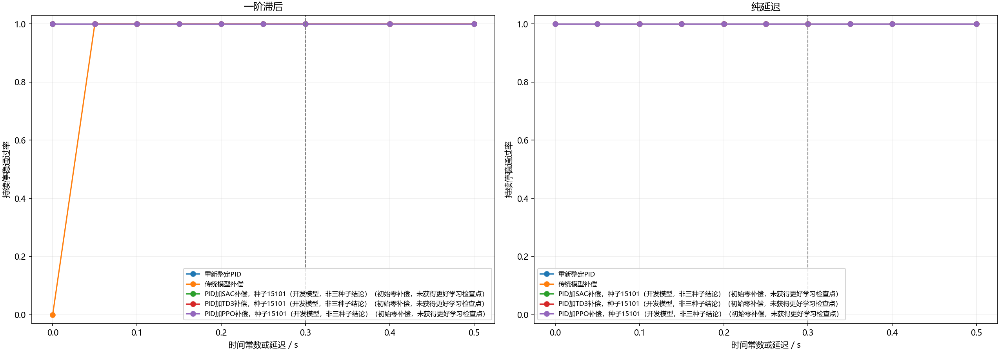
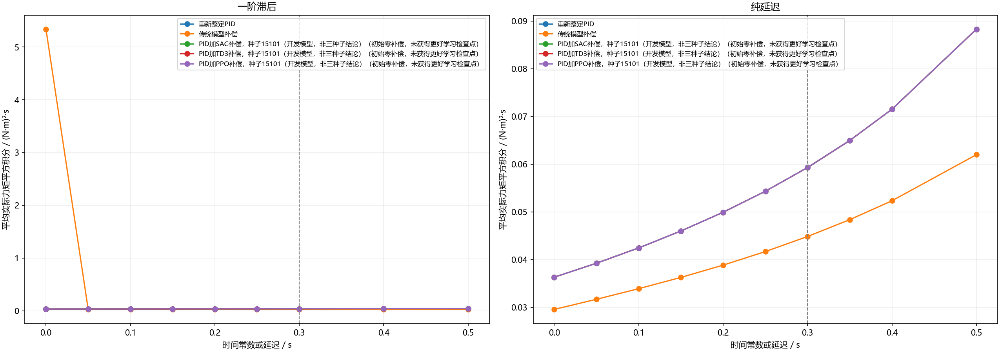

# 修正训练后的连续控制多算法比较

本研究分别比较一阶滞后和纯延迟下的连续力矩控制。SAC、TD3、PPO使用相同观测、相同连续补偿幅度、相同训练交互预算；不把相同步数称为相同算力。开发选择和正式三种子验证分别报告。

主要验收：从8秒起直到22秒的全部采样点，角度误差≤1°、角速度≤0.5°/秒。实际力矩平方积分单位为(N·m)²·s；失败情况下的较低代价不作为收益。

实际完成15次训练，累计2,654,208交互步；独立测试12,160回合，128个独立初态跨参数和控制器复用。

## 修正了什么

失败后保持固定440步计时并持续惩罚，不允许提前结束少受罚；学习补偿从确定性零动作开始，初始行为与PID相同；奖励更重视控制代价与截止后约束；历史窗口覆盖0.6秒。初始化、奖励及检查点选择在训练前声明。实际选中步数为0时，只能解释为回退原PID，不能称为学习成功。

## 理想单轴训练检查

| 算法 | 实际步数 | 最佳验证通过数 | 选中步数 |
| --- | --- | --- | --- |
| PPO | 98304 | 0/64 | 0 |
| SAC | 98304 | 0/64 | 0 |
| TD3 | 98304 | 0/64 | 0 |

这部分仅检查直接策略能否学会简单稳定控制，不用于证明相对PID的正式优势。

## 开发与正式选择

| 执行器 | 算法 | 奖励 | 开发验证通过数 | 平均实际代价 | 选中步数 |
| --- | --- | --- | --- | --- | --- |
| lag | SAC | A | 384/384 | 0.039793 | 0 |
| lag | TD3 | A | 384/384 | 0.039793 | 0 |
| lag | PPO | A | 384/384 | 0.039793 | 0 |
| lag | SAC | B | 384/384 | 0.039793 | 0 |
| lag | TD3 | B | 384/384 | 0.039793 | 0 |
| lag | PPO | B | 384/384 | 0.039793 | 0 |
| delay | SAC | A | 384/384 | 0.055190 | 0 |
| delay | TD3 | A | 384/384 | 0.055190 | 0 |
| delay | PPO | A | 384/384 | 0.055190 | 0 |
| delay | SAC | B | 384/384 | 0.055190 | 0 |
| delay | TD3 | B | 384/384 | 0.055190 | 0 |
| delay | PPO | B | 384/384 | 0.055190 | 0 |

## 一阶滞后

| 方法 | 测试范围 | 完成数 | 平均实际代价 | 全程RMS误差/° | 物理失败 |
| --- | --- | --- | --- | --- | --- |
| 重新整定PID | 范围内 | 768/768 | 0.034785 | 8.666 | 0 |
| 重新整定PID | 理想 | 128/128 | 0.032285 | 8.579 | 0 |
| 重新整定PID | 范围外 | 256/256 | 0.039475 | 8.830 | 0 |
| 传统模型补偿 | 范围内 | 768/768 | 0.026504 | 8.943 | 0 |
| 传统模型补偿 | 理想 | 0/128 | 5.338324 | 15.310 | 0 |
| 传统模型补偿 | 范围外 | 256/256 | 0.027673 | 9.027 | 0 |
| PID加SAC补偿，种子15101（开发模型，非三种子结论）（初始零补偿，未获得更好学习检查点） | 范围内 | 768/768 | 0.034785 | 8.666 | 0 |
| PID加SAC补偿，种子15101（开发模型，非三种子结论）（初始零补偿，未获得更好学习检查点） | 理想 | 128/128 | 0.032285 | 8.579 | 0 |
| PID加SAC补偿，种子15101（开发模型，非三种子结论）（初始零补偿，未获得更好学习检查点） | 范围外 | 256/256 | 0.039475 | 8.830 | 0 |
| PID加TD3补偿，种子15101（开发模型，非三种子结论）（初始零补偿，未获得更好学习检查点） | 范围内 | 768/768 | 0.034785 | 8.666 | 0 |
| PID加TD3补偿，种子15101（开发模型，非三种子结论）（初始零补偿，未获得更好学习检查点） | 理想 | 128/128 | 0.032285 | 8.579 | 0 |
| PID加TD3补偿，种子15101（开发模型，非三种子结论）（初始零补偿，未获得更好学习检查点） | 范围外 | 256/256 | 0.039475 | 8.830 | 0 |
| PID加PPO补偿，种子15101（开发模型，非三种子结论）（初始零补偿，未获得更好学习检查点） | 范围内 | 768/768 | 0.034785 | 8.666 | 0 |
| PID加PPO补偿，种子15101（开发模型，非三种子结论）（初始零补偿，未获得更好学习检查点） | 理想 | 128/128 | 0.032285 | 8.579 | 0 |
| PID加PPO补偿，种子15101（开发模型，非三种子结论）（初始零补偿，未获得更好学习检查点） | 范围外 | 256/256 | 0.039475 | 8.830 | 0 |

**开发没有产生符合门槛的已学习检查点，未进入正式三种子训练。不能把该结果写成算法能力上限。**

## 纯延迟

| 方法 | 测试范围 | 完成数 | 平均实际代价 | 全程RMS误差/° | 物理失败 |
| --- | --- | --- | --- | --- | --- |
| 重新整定PID | 范围内 | 768/768 | 0.048535 | 8.516 | 0 |
| 重新整定PID | 理想 | 128/128 | 0.036307 | 8.432 | 0 |
| 重新整定PID | 范围外 | 384/384 | 0.074930 | 8.663 | 0 |
| 传统模型补偿 | 范围内 | 768/768 | 0.037864 | 8.821 | 0 |
| 传统模型补偿 | 理想 | 128/128 | 0.029557 | 8.737 | 0 |
| 传统模型补偿 | 范围外 | 384/384 | 0.054229 | 8.963 | 0 |
| PID加SAC补偿，种子15101（开发模型，非三种子结论）（初始零补偿，未获得更好学习检查点） | 范围内 | 768/768 | 0.048535 | 8.516 | 0 |
| PID加SAC补偿，种子15101（开发模型，非三种子结论）（初始零补偿，未获得更好学习检查点） | 理想 | 128/128 | 0.036307 | 8.432 | 0 |
| PID加SAC补偿，种子15101（开发模型，非三种子结论）（初始零补偿，未获得更好学习检查点） | 范围外 | 384/384 | 0.074930 | 8.663 | 0 |
| PID加TD3补偿，种子15101（开发模型，非三种子结论）（初始零补偿，未获得更好学习检查点） | 范围内 | 768/768 | 0.048535 | 8.516 | 0 |
| PID加TD3补偿，种子15101（开发模型，非三种子结论）（初始零补偿，未获得更好学习检查点） | 理想 | 128/128 | 0.036307 | 8.432 | 0 |
| PID加TD3补偿，种子15101（开发模型，非三种子结论）（初始零补偿，未获得更好学习检查点） | 范围外 | 384/384 | 0.074930 | 8.663 | 0 |
| PID加PPO补偿，种子15101（开发模型，非三种子结论）（初始零补偿，未获得更好学习检查点） | 范围内 | 768/768 | 0.048535 | 8.516 | 0 |
| PID加PPO补偿，种子15101（开发模型，非三种子结论）（初始零补偿，未获得更好学习检查点） | 理想 | 128/128 | 0.036307 | 8.432 | 0 |
| PID加PPO补偿，种子15101（开发模型，非三种子结论）（初始零补偿，未获得更好学习检查点） | 范围外 | 384/384 | 0.074930 | 8.663 | 0 |

**开发没有产生符合门槛的已学习检查点，未进入正式三种子训练。不能把该结果写成算法能力上限。**

## 核验与结论范围

每个响应分片均独立重算动力学、连续实际力矩积分、历史特征、确定性网络动作、抗饱和PID状态及全部验收指标；检查源码、参数、模型、场景及响应哈希。主比较按初态聚类，12个区间作Bonferroni校正。

本研究仍是单轴实验。三轴需要针对完整耦合模型另行联合训练，不以逐轴迁移代替。若本轮没有优势，按计划进入三个有工程机制的后续场景，保留本轮阴性结果。

复核：`python -X utf8 -B 运行研究.py verify`；重建报告：`python -X utf8 -B 运行研究.py report`。

失败方法的实际代价仅供诊断，不与成功方法解释为同等任务下的节省。
