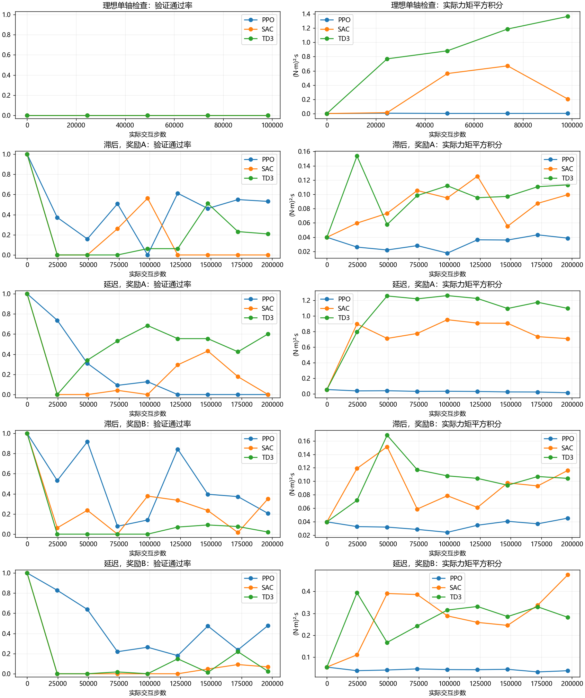

# 三种算法究竟训练到了什么程度

“训练程序运行完了”和“控制任务已经学会了”是两件事。应看独立验证表现、检查点和不同种子，不能只报交互步数。

|阶段|执行器|算法|奖励|种子|实际步数|选中步数|最佳通过数|最后通过数|
|---|---|---|---|---|---|---|---|---|
|development|delay|PPO|A|15101|196608|0|384/384|0/384|
|development|delay|PPO|B|15202|196608|0|384/384|184/384|
|development|delay|SAC|A|15101|196608|0|384/384|0/384|
|development|delay|SAC|B|15202|196608|0|384/384|26/384|
|development|delay|TD3|A|15101|196608|0|384/384|231/384|
|development|delay|TD3|B|15202|196608|0|384/384|9/384|
|development|lag|PPO|A|15101|196608|0|384/384|204/384|
|development|lag|PPO|B|15202|196608|0|384/384|79/384|
|development|lag|SAC|A|15101|196608|0|384/384|0/384|
|development|lag|SAC|B|15202|196608|0|384/384|135/384|
|development|lag|TD3|A|15101|196608|0|384/384|80/384|
|development|lag|TD3|B|15202|196608|0|384/384|8/384|
|sanity|ideal|PPO|A|15013|98304|0|0/64|0/64|
|sanity|ideal|SAC|A|15011|98304|0|0/64|0/64|
|sanity|ideal|TD3|A|15012|98304|0|0/64|0/64|

共12次补偿训练选中了第0步。第0步时网络补偿为零，行为就是原PID；它说明保留原控制器比已保存的学习检查点更合适，不能写成强化学习已经达到PID性能。

三个算法在本轮理想单轴检查中都未达到严格的持续停稳要求。这说明本轮观测、奖励、超参数和训练预算的组合仍不足，不能将阴性结果归结为这些算法理论上不适合卫星控制。

SAC、TD3和PPO的输出均为连续补偿力矩。这里没有把顺时针/逆时针等简单方向选择包装成学习控制。

全部失败尝试保留。新的工程场景另立假设、数据划分和验收，不能反复更改本轮测试条件直到出现预期结论。

右图必须结合左图阅读：未完成任务时，代价低不能当作收益。
