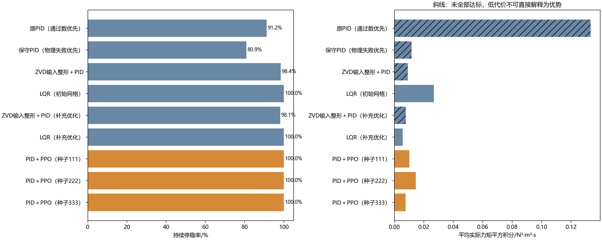
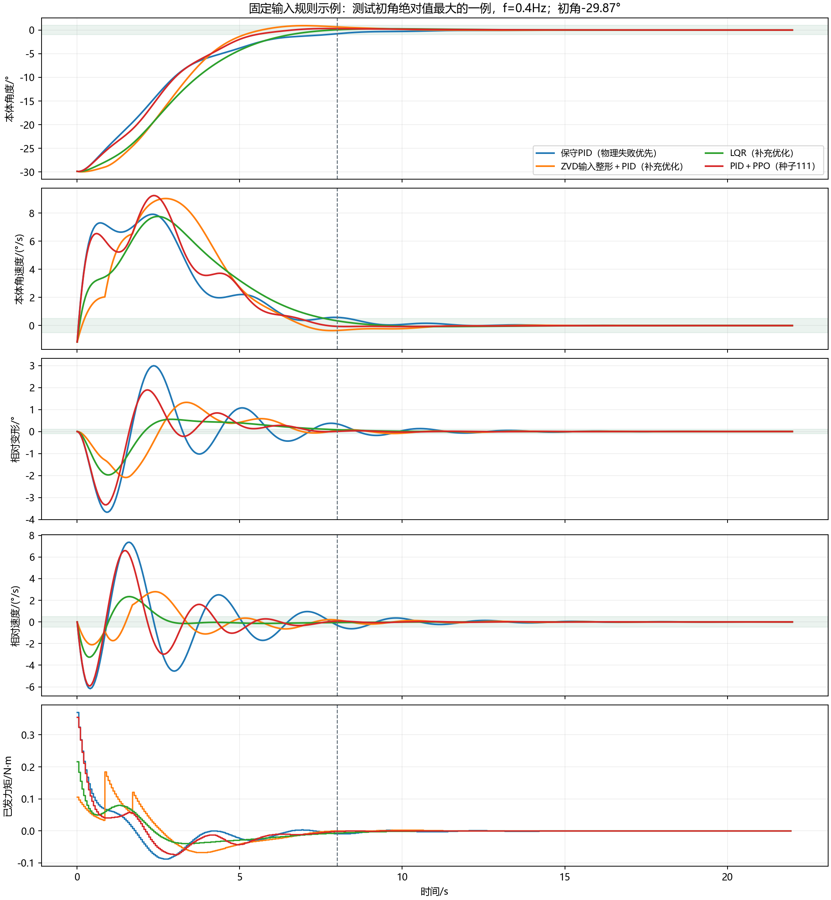

# 柔性附体振动抑制：最终报告

这次比较研究本体转向时的附体振动，不是路线选择。学习模型每0.05s输出连续力矩补偿，传统PID仍承担基本反馈。所有方法都有相同的本体和附体测量信息，真实频率与阻尼没有输入策略。

同样要求：8s后直到22s，本体误差≤1°、角速度≤0.5°/s、附体相对变形≤0.1°、相对速度≤0.5°/s；命令力矩≤0.5N·m。

| 方法 | 持续停稳/640 | 物理失败 | 平均力矩平方积分 | 平均残余变形均方根/° |
|---|---:|---:|---:|---:|
| 原PID（通过数优先） | 584/640 | 27 | 0.1331790 | 0.43977 |
| 保守PID（物理失败优先） | 518/640 | 0 | 0.0117467 | 0.01339 |
| ZVD输入整形＋PID | 630/640 | 0 | 0.0091508 | 0.00626 |
| LQR（初始网格） | 640/640 | 0 | 0.0267880 | 0.00248 |
| ZVD输入整形＋PID（补充优化） | 628/640 | 0 | 0.0077119 | 0.00670 |
| LQR（补充优化） | 640/640 | 0 | 0.0055636 | 0.00436 |
| PID＋PPO（种子111） | 640/640 | 0 | 0.0101200 | 0.00502 |
| PID＋PPO（种子222） | 640/640 | 0 | 0.0144832 | 0.00536 |
| PID＋PPO（种子333） | 640/640 | 0 | 0.0075496 | 0.00350 |

控制代价是实际力矩平方积分，不是电能。失败提前吸收可能降低它，因此没有全部达标的控制器，不能仅靠表里的较小代价宣称更省。

每种方法640回合来自128个独立初态×五个频率。置信区间按128个初态组重采样，不把640回合全当独立样本；36项同时比较使用Bonferroni校正。

- 相对原PID（通过数优先）：三种子一致的完成率优势=True；双方全部达标条件下的代价优势=False。
- 相对保守PID（物理失败优先）：三种子一致的完成率优势=True；双方全部达标条件下的代价优势=False。
- 相对ZVD输入整形＋PID：三种子一致的完成率优势=True；双方全部达标条件下的代价优势=False。
- 相对LQR（初始网格）：三种子一致的完成率优势=False；双方全部达标条件下的代价优势=True。
- 相对ZVD输入整形＋PID（补充优化）：三种子一致的完成率优势=True；双方全部达标条件下的代价优势=False。
- 相对LQR（补充优化）：三种子一致的完成率优势=False；双方全部达标条件下的代价优势=False。

本轮完整开发及正式训练共4,718,592交互步，6次从零训练。三种子所选检查点步数分别为262144、393216、327680。训练末模型可能退化，所以按照预先固定规则选择验证集最佳检查点，独立测试没有参与选择。

正式及补充独立测试共5,760回合，全部物理状态转移用独立状态空间矩阵指数重建，指令和指标同时核验通过。

第一次开发的未成功结果留在上一级；第一次SAC中止的精确总步数没有保存，不能编造一个精确值，也不计入这里可精确核算的本轮训练总步数。

局限：双惯量单柔性模态近似、理想力矩源、无测量噪声、假设可测附体振动；没有实物验证。优于PID不等于优于全部传统控制，补充优化的ZVD和LQR结果必须同时展示。

## 事后加强PID复核

主测试之后，另从3825个已保存候选中只用开发/验证指标重选成功数优先的PID。新PID为593/640=92.66%，27次模型适用范围越界，比原PID更强，仍低于三个PPO的100%。这是事后复核，不伪装成先验主比较；另有640回合全量物理核验，本研究总测试回合数因此为6400。

10°越界仅表示超出线性模型的适用范围，不等于实物卫星结构损坏。
