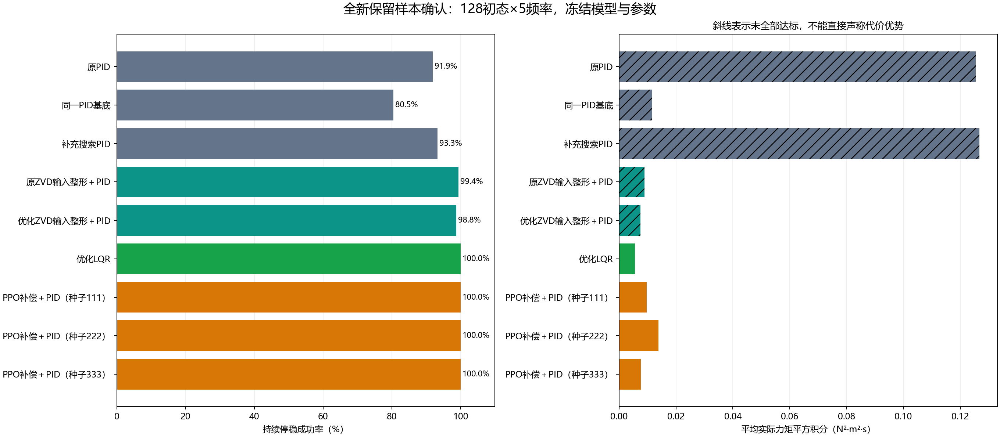
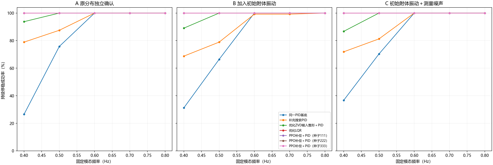

# 柔性附体研究：全新样本确认、初始振动与测量噪声

本补充实验使用此前已经固定的三个PPO模型和六种传统控制器，不进行新训练或调参。它解决原先补充搜索PID只在旧测试样本复核的问题，并检查初始附体振动和测量噪声对结果的影响。全部方案、源码、模型、传统参数、初态和共享噪声先冻结，再执行新测试。

## 1. 任务和工程含义

卫星本体转向会带动柔性附件振动。这里用本体与附体通过弹性、阻尼连接的双惯量单模态模型近似，控制力矩作用于本体。每0.05秒更新一次指令，每回合22秒；要求从8秒开始一直到22秒，本体角度≤1°、本体角速度≤0.5°/s、附体相对角度≤0.1°、相对角速度≤0.5°/s，力矩限制±0.5 N·m。四项条件必须同时持续满足。

附体初始小振动可对应前一次机动或展开后尚未完全衰减的振动；测量噪声用于检查小幅传感误差。噪声标准差是假定的仿真工况，没有经过具体硬件标定。真实状态决定动力学、失败和验收；控制器只读取加噪测量。

## 2. 预先固定的实验条件

三组各128个全新独立初态，每个初态测试0.4、0.5、0.6、0.7、0.8 Hz五个频率。频率和阻尼在一回合内固定。每组每方法640回合，共9方法×3组×640＝17,280回合。三组初态独立抽样，因此组间成功率差不能全部归因于新增因素；它们各自估计相应分布下的表现，A组是主要独立确认，B/C是鲁棒性补充。

- A：沿用原初态分布，本体初角±30°、初始角速度±2°/s、阻尼比0.01–0.04，附体初始相对角度和速度为0。
- B：其他同A，附体初始相对角度均匀分布±0.05°，相对角速度均匀分布±0.2°/s。
- C：其他同B，四个状态各叠加独立零均值高斯白噪声，标准差依次为[0.01°、0.02°/s、0.005°、0.02°/s]。初始采样也加噪；每个场景在所有方法间使用同一份噪声。

九种方法是：原PID、学习补偿使用的同一PID基底、从3825个历史候选中补充选择的PID、原ZVD输入整形＋PID、优化ZVD输入整形＋PID、优化LQR，以及PPO种子111、222、333。补充搜索PID在旧研究中属于事后复核，在本次新样本中参数事先冻结，故A组可以提供新的前瞻独立确认。

## 3. 统计方法

主要检验为三份PPO各自相对补充搜索PID、同一PID基底的成功率差，共3组×3种子×2参照＝18项。按128个独立初态聚类重采样，每次保留该初态全部五个频率，200,000次配对bootstrap；对18项做Bonferroni校正，报告99.7222%双侧区间。仅当三个种子相对两个参照的区间下界全部大于0，才称该组主要优势确认成立。

次级指标是实际力矩平方积分和8–22秒附体残余相对角度RMS。与六个传统参照的108项配对比较另作为一族做Bonferroni校正，区间置信水平99.9537%。代价优势只在双方640回合全部成功时判断，失败吸收后力矩变零导致的低代价不能当作优势。全回合本体角度RMS、峰值相对角度和频率分组仅作描述。力矩平方积分不是电能。

## A 原分布独立确认：结果

|方法|持续停稳/640|物理越界回合|平均力矩平方积分|平均残余相对角度RMS（°）|
|---|---:|---:|---:|---:|
|原PID|588/640|27|0.1255027|0.439077|
|同一PID基底|515/640|0|0.0115842|0.012918|
|补充搜索PID|597/640|27|0.1267549|0.437938|
|原ZVD输入整形＋PID|636/640|0|0.0089016|0.005777|
|优化ZVD输入整形＋PID|632/640|0|0.0075267|0.006211|
|优化LQR|640/640|0|0.0055256|0.004280|
|PPO补偿＋PID（种子111）|640/640|0|0.0097426|0.004980|
|PPO补偿＋PID（种子222）|640/640|0|0.0138753|0.005229|
|PPO补偿＋PID（种子333）|640/640|0|0.0076352|0.003351|

三个PPO种子相对两个PID参照的主要优势确认：成立。

|PPO种子|参照|成功率差（百分点）|同时校正区间（百分点）|下界>0|
|---|---|---:|---:|---|
|111|补充搜索PID|6.719|[3.750, 10.000]|是|
|111|同一PID基底|19.531|[15.781, 23.281]|是|
|222|补充搜索PID|6.719|[3.750, 10.000]|是|
|222|同一PID基底|19.531|[15.781, 23.281]|是|
|333|补充搜索PID|6.719|[3.750, 10.000]|是|
|333|同一PID基底|19.531|[15.781, 23.281]|是|

## B 加入初始附体振动：结果

|方法|持续停稳/640|物理越界回合|平均力矩平方积分|平均残余相对角度RMS（°）|
|---|---:|---:|---:|---:|
|原PID|573/640|40|0.1423450|0.645019|
|同一PID基底|509/640|0|0.0129661|0.014030|
|补充搜索PID|571/640|40|0.1439362|0.646770|
|原ZVD输入整形＋PID|628/640|0|0.0100940|0.006602|
|优化ZVD输入整形＋PID|626/640|0|0.0084995|0.007058|
|优化LQR|640/640|0|0.0061229|0.004532|
|PPO补偿＋PID（种子111）|640/640|0|0.0108502|0.005379|
|PPO补偿＋PID（种子222）|640/640|0|0.0158310|0.005630|
|PPO补偿＋PID（种子333）|640/640|0|0.0083174|0.003555|

三个PPO种子相对两个PID参照的主要优势确认：成立。

|PPO种子|参照|成功率差（百分点）|同时校正区间（百分点）|下界>0|
|---|---|---:|---:|---|
|111|补充搜索PID|10.781|[6.719, 15.469]|是|
|111|同一PID基底|20.469|[16.250, 24.687]|是|
|222|补充搜索PID|10.781|[6.719, 15.469]|是|
|222|同一PID基底|20.469|[16.250, 24.687]|是|
|333|补充搜索PID|10.781|[6.719, 15.469]|是|
|333|同一PID基底|20.469|[16.250, 24.687]|是|

## C 初始附体振动＋测量噪声：结果

|方法|持续停稳/640|物理越界回合|平均力矩平方积分|平均残余相对角度RMS（°）|
|---|---:|---:|---:|---:|
|原PID|574/640|35|0.1336274|0.566121|
|同一PID基底|521/640|0|0.0119391|0.013660|
|补充搜索PID|580/640|36|0.1349884|0.582821|
|原ZVD输入整形＋PID|624/640|0|0.0093391|0.006929|
|优化ZVD输入整形＋PID|623/640|0|0.0078571|0.007310|
|优化LQR|640/640|0|0.0056362|0.004579|
|PPO补偿＋PID（种子111）|640/640|0|0.0100321|0.005700|
|PPO补偿＋PID（种子222）|640/640|0|0.0146498|0.005965|
|PPO补偿＋PID（种子333）|640/640|0|0.0076441|0.004183|

三个PPO种子相对两个PID参照的主要优势确认：成立。

|PPO种子|参照|成功率差（百分点）|同时校正区间（百分点）|下界>0|
|---|---|---:|---:|---|
|111|补充搜索PID|9.375|[5.625, 13.594]|是|
|111|同一PID基底|18.594|[14.375, 22.812]|是|
|222|补充搜索PID|9.375|[5.625, 13.594]|是|
|222|同一PID基底|18.594|[14.375, 22.812]|是|
|333|补充搜索PID|9.375|[5.625, 13.594]|是|
|333|同一PID基底|18.594|[14.375, 22.812]|是|

## 7. 论文图与结果解释

主要结论只涉及这几组分布及冻结控制器。PPO相对PID的结果与相对ZVD、LQR的结果必须同时报告。LQR使用本体和附体的完整测量状态；这说明充分利用柔性状态的传统控制具有竞争力。不能从“优于某组PID”推出“优于所有传统控制”。三个学习种子均展示，不以最好一个代替整体。

越过10°相对角度表示超出本研究线性近似有效范围，不代表已经证明真实附件损坏。未进行具体飞行卫星、执行器动态、传感器校准、完整柔性多模态或硬件验证。含噪组使用未在含噪条件下重新训练的模型和未经含噪重整定的控制器，研究的是现有设计直接使用时的鲁棒性，不能作为双方充分针对噪声优化后的最优能力比较。

## 8. 独立核验与材料位置

全量17,280回合、7,603,200个状态转移通过独立SciPy状态空间矩阵指数核验。最大单步状态差异为2.220e-16，按记录指令从初态逐步重放最大差异为1.564e-14，全部策略动作复算差异为0.000e+00。每个测量值都与真实状态＋冻结共享噪声逐元素一致；四项验收、越界、代价与误差指标另行重算。

该核验使用独立的物理状态空间矩阵指数，但使用冻结的原控制器和PPO实现复算动作，不声称重新独立实现了强化学习算法。所有输出文件均有哈希清单。新关键测试另检查零噪声与原实现一致、非零初始振动正确保留、噪声只进入测量及真值验收、共享噪声与随机样本独立。

- `01_方案与冻结/`：测试前冻结方案、源码/模型/参数哈希、全新初态和共享噪声。
- `02_新独立测试/`：27组完整真值、测量、策略动作、指令和逐回合指标。
- `03_独立核验/verification.json`：全量状态/动作/噪声/指标核验。
- `04_统计/paired_statistics.json`：18项主比较与108项次比较。
- `结果摘要.json`：供论文和总览读取的固定结构摘要。

