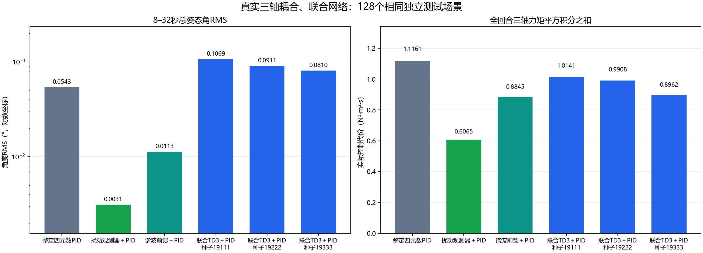
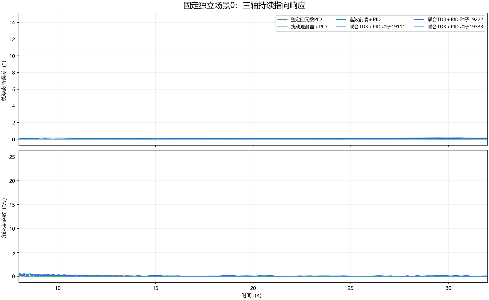

# 周期扰动下的三轴联合学习控制

本次三轴实验没有证明强化学习优于PID。三个从零训练的联合TD3模型虽然降低了实际力矩平方积分，但稳态指向误差均比PID更大；其中两个模型也没有在全部测试场景中持续满足角速度要求。这个结果完整保留，不用单轴的正结果代替三轴结论。

## 1. 研究问题和物理模型

研究问题是：在存在周期扰动、与姿态和角速度有关的扰动，以及执行器一阶滞后的情况下，一个同时控制三个轴的TD3补偿器，能否提高经过整定的PID的指向精度？

卫星动力学采用主惯量为[1.2, 1.0, 0.8]的刚体Euler方程，包含ω×(Jω)陀螺耦合；姿态用单位四元数表示。每个执行器的时间常数为0.15秒，单轴指令限制为±0.5 N·m，采样周期0.05秒。一个网络同时输出三维连续补偿力矩，每轴补偿限制为±0.12 N·m，补偿加到同一套PID上后再执行总指令限幅。所有控制器都使用相同的已知陀螺项前馈。

每轴扰动为A₁sinφ＋A₂sin(2φ＋0.4)＋cθsin(2θ)＋cωtanh(ω/0.05)。θ为相对目标姿态旋转向量的对应分量，不是将三个Euler角分别代入三个互不关联的模型。每回合独立随机改变扰动幅值、相位、频率和系数。这个模型用于研究具有重复结构的扰动，未建模具体卫星的轨道环境、柔性帆板和反作用轮。

所有适用控制器都能获得姿态误差、角速度、周期扰动相位和频率。网络另外使用自己累积的积分量、过去发出的指令和时间；真实扰动力矩、扰动系数与实际执行器力矩均不提供给网络。扰动观测器根据可测运动响应估计扰动，谐波前馈根据开发场景的数据拟合系数。

## 2. 对比和验收方法

独立开发场景24个、验证场景48个、最终测试场景128个，三组随机数种子分别为202610181901、202610181902、202610181903。每个初始姿态分量在±12°内、角速度分量在±1°/s内随机选取。测试场景不参与PID整定、网络结构选择或模型选择；测试过程中权重不更新。

每回合32秒，要求从第8秒到第32秒的每一个采样点，总姿态角误差均不超过2°、角速度向量范数均不超过1°/s。这里检查的是总姿态误差与向量范数，比逐轴分别判断更明确。主要精度指标是8–32秒总姿态角误差的均方根（RMS）；控制代价是0–32秒三轴实际输出力矩平方积分之和，并非实测电能。

预先规定的优势条件是：PID与三个正式模型都完成全部128个场景；三个模型相对PID的配对RMS改善区间下界都大于0；每个模型的平均控制代价不超过PID的110%。三个区间使用Bonferroni调整后的98.333%置信水平。

传统控制独立完成857组PID开发候选、120组扰动观测器组合和10组谐波前馈组合搜索，再在验证场景选择；PID和扰动观测器各24组候选进入验证，谐波前馈10组进入验证。三个传统控制器在验证场景均为48/48成功。

## 3. 训练做了多少，模型怎样选

先比较两个网络配置，每个开发训练262,144步。配置A为[128,128]，验证48/48成功；配置B为[256,128]，验证17/48成功。按预声明规则选择配置A，再以三个新随机种子分别从零训练524,288步。总计5次训练、2,097,152次环境交互。

随机种子是初始化网络和产生训练随机样本的可复现编号，不代表第几种算法。三个正式模型均保留，并未只展示效果最好的一个。模型每32,768步验证一次，按物理失败数、成功数、稳态RMS和控制代价依次排序选取检查点。正式种子19111的验证成功数只有43/48，也照常进入最终测试，不事后剔除失败模型。

|正式种子|实际训练步数|选中的检查点步数|验证成功数|
|---|---:|---:|---:|
|19111|524,288|524,288|43/48|
|19222|524,288|229,376|48/48|
|19333|524,288|229,376|48/48|

训练开始时将actor输出层权重乘0.01、偏置设为0，使初始补偿较小，但初始网络并非严格输出零。本研究没有把第0步模型作为候选，因此不存在“选中的模型实际就是没有学习的PID”的情况。显式设补偿为零时与PID相同，已另经测试确认。

## 4. 最终独立测试结果

|方法|128场景成功数|8–32秒总姿态角RMS（°）|三轴实际力矩平方积分之和（N²·m²·s）|
|---|---:|---:|---:|
|整定四元数PID|128/128|0.054265|1.116127|
|扰动观测器＋PID|128/128|0.003122|0.606460|
|谐波前馈＋PID|128/128|0.011307|0.884450|
|联合TD3补偿＋PID（种子19111）|113/128|0.106863|1.014055|
|联合TD3补偿＋PID（种子19222）|124/128|0.091084|0.990779|
|联合TD3补偿＋PID（种子19333）|128/128|0.081038|0.896212|

|正式种子|PID减去学习控制RMS的98.333%配对区间（°）|代价相对PID降低|预声明主结论|
|---|---:|---:|---|
|19111|[-0.055283, -0.049843]|9.1%|不成立|
|19222|[-0.039661, -0.033914]|11.2%|不成立|
|19333|[-0.028954, -0.024552]|19.7%|不成立|

区间全部为负，表示这三份学习模型的RMS均高于PID，而不是精度改善。种子19333虽然达到128/128成功、平均代价降低19.7%，但误差RMS由PID的0.054265°上升到0.081038°；只能说它选择了较低控制代价与较大误差的取舍。种子19111和19222的部分场景没有持续停稳，不能以平均代价较低概括为更优。

扰动观测器＋PID的精度和代价都优于三个学习模型；谐波前馈也比学习模型更精确。不能把相对普通PID的研究问题扩展为“学习控制优于传统控制”。

## 5. 结果核验范围

六个控制器共768回合均通过冻结源码、模型、场景和响应文件哈希检查。全部控制指令与轨迹重新执行后最大差异为0.0；用记录的四元数独立重算验收与RMS，用执行器解析解重算积分代价，均一致。最大单位四元数范数误差为2.220e-16，每步代价解析复算最大差异为2.602e-17。这部分核验验证可复现性与指标一致性。

另用独立编写的Euler方程、四元数运动学和执行器方程，以SciPy自适应积分对全部768回合重新进行闭环仿真；每个采样点按独立仿真状态重新计算控制指令。全部场景的成功与失败判断，以及三个预声明统计结论全部复现。最大瞬态总姿态角差异为8.404e-07°、角速度分量差异为1.973e-07 rad/s、实际力矩差异为2.808e-06 N·m、回合积分代价差异为1.651e-07。独立积分复核使用同一冻结控制器实现，物理积分方程单独实现；它不等于重新独立实现整套学习算法。

训练前还完成物理与集成测试，包括Euler耦合、四元数变换、能量/角动量守恒、执行器解析积分、失败重置，以及独立32秒DOP853响应与步长收敛。共9项测试通过。

## 6. 可以怎样写入答辩

“我们在单轴周期扰动任务中观察到学习补偿相对PID的精度和代价改善，但在真实Euler耦合、四元数姿态和联合三维动作下，当前TD3训练方案没有保留这一优势。三个独立训练模型的稳态误差均高于PID，两个模型未在所有场景持续停稳。传统扰动观测器在本次单轴和三轴模型中都更有效。因此，本项目证明的是学习补偿在特定条件下的可用性，同时给出了向三轴扩展时的实验证据和限制。”

这项负结果约束的是本次建模、训练预算、奖励和所测试模型，不能证明强化学习在三轴问题上理论上不可行。测试结果已经公开并锁定，后续若调整训练方案，应另立新的开发与独立测试场景，不能用本次测试数据反复选模型。

## 7. 支撑材料

- `01_方案与场景/预声明.json`：物理条件、数据划分、训练预算和优势条件。
- `02_传统控制/selected.json`：传统控制器参数及开发、验证过程。
- `03_训练/`：两个开发模型、三个正式模型、全部检查点验证记录。
- `04_独立测试/`：768回合原始响应、指标、冻结清单与统计比较。
- `05_独立核验/verification.json`：全部记录、指令、验收和代价复核。
- `05_独立核验/独立高精度闭环复核.json`：独立自适应积分闭环复核。
- `代码/physics.py`与`代码/joint_study.py`：冻结的物理、控制、训练和评价实现。

