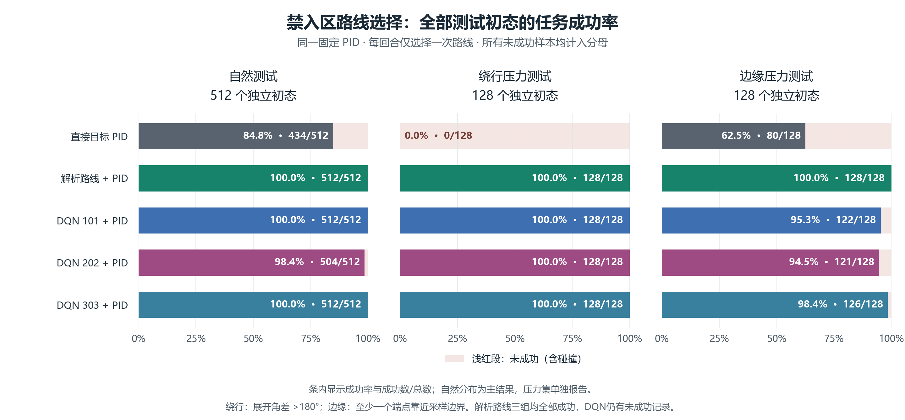
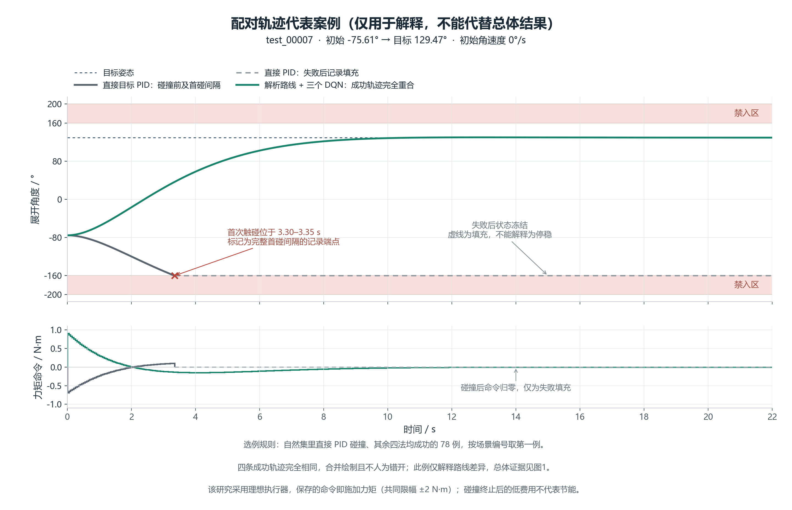

# 后续研究结果说明：执行器误差与姿态禁入区

**找到了强化学习相对直接目标PID的明确优势：在本次姿态禁入区任务的512个独立测试场景中，DQN路线选择加PID的三个种子完成率为98.44%～100.00%，直接目标PID为84.77%。解析路线规划加PID为100%，因此没有证明学习优于解析规划。**

执行器一阶滞后、纯延迟和三轴迁移也全部保留。它们与禁入区是不同任务，分别采用各自预先声明的训练、验证和独立测试数据，不能混成一个实验的排名。

## 一、这次依次做了什么

第一步，分别给单轴执行器加入一阶滞后和纯延迟，比较调参后的PID、传统模型补偿、直接SAC、PID加SAC补偿。先用开发集和验证集选参数、奖励与检查点，再冻结控制器进行独立测试。

第二步，把已训练的单轴控制器逐轴用于带完整刚体耦合的三轴模型，并加入重新整定的三轴PID作比较。这一步是迁移验证，没有另训三轴联合SAC。

第三步，另立“姿态禁入区”任务。目标不仅是转到指定角度，还必须全程避开禁止朝向。用DQN选择转动方向，随后由与传统对照完全相同的PID完成反馈控制。

## 二、先看一阶滞后和纯延迟的结果

一阶滞后：指令改变后，实际力矩逐渐靠近指令。纯延迟：指令先等待一段时间，再原样执行。每回合的时间常数或延迟在训练范围0.05～0.30秒内抽取，回合内固定；测试时控制器不知道真实值。

验收要求是从第8秒起直到第22秒，每个采样点都满足角度误差不超过1°、角速度不超过0.5°/秒。所有控制器使用同一批初态、同一力矩限制和同一运行时长。

直接SAC在开发阶段没有达到95%的验证通过门槛，只保留开发候选作诊断。PID加SAC补偿达到开发门槛，随后完成三个全新种子的正式训练；所有种子均保留，不根据测试成绩删选。

### 一阶滞后：训练范围内的独立测试

| 方法 | 完成数 | 完成率 | 平均实际力矩平方积分 | 全程RMS误差/° |
| --- | --- | --- | --- | --- |
| 调参后的PID | 1536/1536 | 100.00% | 0.026696 | 8.843 |
| 传统模型补偿 | 1536/1536 | 100.00% | 0.029194 | 8.672 |
| 直接SAC（种子9101），仅开发诊断 | 0/1536 | 0.00% | 0.036824 | 13.841 |
| PID加SAC补偿（种子101） | 1536/1536 | 100.00% | 0.075307 | 7.756 |
| PID加SAC补偿（种子202） | 1536/1536 | 100.00% | 0.103749 | 7.270 |
| PID加SAC补偿（种子303） | 1536/1536 | 100.00% | 0.106752 | 7.372 |

### 纯延迟：训练范围内的独立测试

| 方法 | 完成数 | 完成率 | 平均实际力矩平方积分 | 全程RMS误差/° |
| --- | --- | --- | --- | --- |
| 调参后的PID | 1536/1536 | 100.00% | 0.031125 | 8.860 |
| 传统模型补偿 | 1536/1536 | 100.00% | 0.035805 | 8.682 |
| 直接SAC（种子9102），仅开发诊断 | 0/1536 | 0.00% | 0.171317 | 13.508 |
| PID加SAC补偿（种子101） | 1412/1536 | 91.93% | 0.275567 | 8.010 |
| PID加SAC补偿（种子202） | 1091/1536 | 71.03% | 0.188848 | 7.257 |
| PID加SAC补偿（种子303） | 1536/1536 | 100.00% | 0.184535 | 8.119 |

**这轮单轴实验没有得到满足预定可靠性要求的SAC代价优势。** 补偿方法即使在某些场景响应更快，也要同时看力矩代价和持续停稳，不能只挑较好的一项写“全面更优”。

这里的代价是0～22秒实际力矩平方积分，单位为(N·m)²·s。它衡量施加力矩的强度与持续时间，不是实测电能。任务失败时较小的代价不能解释为节能。

另外，独立诊断发现这轮SAC奖励存在一种不足：某些提前失效的固定动作，其回报高于长时间不完成任务。这说明奖励可能给出不恰当的激励，不能据本轮直接SAC失败推断“SAC不适合卫星控制”。诊断只是构造反例，没有证明某个模型确实主动利用了它。原模型和原结果保留，未在测试后更换奖励。

[完整单轴结果、训练范围外结果与图表](../12_执行器滞后与纯延迟对比研究/06_结果与说明/研究结果说明.md)；[奖励设计诊断](../12_执行器滞后与纯延迟对比研究/05_独立核验/奖励设计诊断.md)。

## 三、三轴做到了哪一步

三轴模型保留欧拉刚体动力学中的陀螺耦合项，采用四元数表示姿态，惯量为[1.2, 1.0, 0.8] kg·m²。不能把它看成三份完全独立的单轴仿真。

下表是训练参数范围内的独立迁移结果。每个方法使用128个新初态与6个执行器参数，共768回合；不同参数下复用同一初态。

| 执行器 | 方法 | 完成数 | 平均实际力矩平方积分 |
| --- | --- | --- | --- |
| 一阶滞后 | 重新整定三轴PID | 766/768 | 0.041137 |
| 一阶滞后 | 单轴PID逐轴迁移 | 504/768 | 0.036023 |
| 一阶滞后 | 单轴传统补偿逐轴迁移 | 756/768 | 0.039457 |
| 一阶滞后 | 单轴直接SAC逐轴迁移（种子9101），仅开发诊断 | 0/768 | 0.070597 |
| 一阶滞后 | 单轴PID加SAC逐轴迁移（种子101） | 36/768 | 0.129691 |
| 一阶滞后 | 单轴PID加SAC逐轴迁移（种子202） | 768/768 | 0.183010 |
| 一阶滞后 | 单轴PID加SAC逐轴迁移（种子303） | 701/768 | 0.196755 |
| 纯延迟 | 重新整定三轴PID | 768/768 | 0.069677 |
| 纯延迟 | 单轴PID逐轴迁移 | 494/768 | 0.042050 |
| 纯延迟 | 单轴传统补偿逐轴迁移 | 620/768 | 0.048384 |
| 纯延迟 | 单轴直接SAC逐轴迁移（种子9102），仅开发诊断 | 0/768 | 0.465231 |
| 纯延迟 | 单轴PID加SAC逐轴迁移（种子101） | 119/768 | 0.617906 |
| 纯延迟 | 单轴PID加SAC逐轴迁移（种子202） | 3/768 | 0.436495 |
| 纯延迟 | 单轴PID加SAC逐轴迁移（种子303） | 0/768 | 0.454872 |

三轴迁移没有表现出跨种子的稳定优势。一阶滞后中，补偿种子202完成768/768，重新整定三轴PID为766/768，但该学习模型的平均代价约为PID的4.45倍，另外两个学习种子的通过率也不一致。纯延迟中，重新整定PID完成768/768，三个学习补偿模型分别只完成119、3、0回合。不能只挑种子202宣称强化学习更好。

迁移条件同时改变了惯量、多轴姿态几何与耦合，并使用整体姿态角和角速度向量范数验收。通过率下降不能单独归因于“耦合”；也不能据此推断三轴联合训练的效果。

[三轴迁移研究报告及全部测试范围](../13_执行器误差下的三轴耦合迁移验证/研究报告.md)。

## 四、在哪个任务中找到了学习方法的优势

设卫星有一段禁止朝向，例如某载荷需要避开太阳方向。我们把它简化为单轴角度圆上的固定禁入弧[160°, 200°]，任务要求转到目标，同时全程不进入这段区域。这里是简化模型，没有使用真实太阳星历或真实载荷。

普通目标PID根据当前角度误差决定转动，却没有选择安全路线的功能。例如从约−76°转到129°，按角度圆上的较短方向转动会经过−180°，恰好落在禁入区；选择经过0°的另一条路线才能安全到达。单纯调整PID增益不能给它增加路线规划功能。

DQN适合这里的离散选择：每回合只选一次顺时针或逆时针，然后把路线交给同一个固定PID。网络没有在测试时继续训练，也没有获得正确方向标签；它根据训练环境返回的整条路线奖励学习选择。这个问题是单步决策，不是复杂的连续强化学习控制。

三个对照分别是：直接目标PID、解析路线规划加PID、DQN路线选择加PID。底层PID参数完全相同；搜索允许积分项，最终选择的积分增益为0，所以实际执行的是PD形式。禁入区任务采用理想执行器，力矩上限为2 N·m，12秒完成并持续验收到22秒；与前两项执行器研究分别报告。

### 自然测试分布：主要结果

| 方法 | 完成数 | 完成率 | 碰撞次数 |
| --- | --- | --- | --- |
| 直接目标PID | 434/512 | 84.77% | 78 |
| 解析路线规划加PID | 512/512 | 100.00% | 0 |
| DQN路线选择加PID（种子101） | 512/512 | 100.00% | 0 |
| DQN路线选择加PID（种子202） | 504/512 | 98.44% | 8 |
| DQN路线选择加PID（种子303） | 512/512 | 100.00% | 0 |

三个DQN种子相对直接目标PID的配对完成率增益如下。区间以独立场景为单位计算，并对三次比较作Bonferroni校正。

| 种子 | 完成率提高/百分点 | 校正后98.333%区间/百分点 |
| --- | --- | --- |
| 101 | 15.23 | [11.52, 19.14] |
| 202 | 13.67 | [9.57, 17.77] |
| 303 | 15.23 | [11.52, 19.14] |

三个区间均高于0，支持“在本次测试分布下，增加学习路线选择提高了直接目标PID的任务完成率”。它不是学习反馈胜过PID的证据；两者底层反馈是同一个PID。

### 压力测试：保留没有成功的场景

| 方法 | 绕行集完成数/128 | 边缘集完成数/128 |
| --- | --- | --- |
| 直接目标PID | 0 | 80 |
| 解析路线规划加PID | 128 | 128 |
| DQN路线选择加PID（种子101） | 128 | 122 |
| DQN路线选择加PID（种子202） | 128 | 121 |
| DQN路线选择加PID（种子303） | 128 | 126 |

绕行集专门抽取需要绕行的情况；边缘集专门抽取靠近允许采样范围边界的情况。它们分别有128个新场景，不能代替自然分布作为主要结果。DQN仍有碰撞，解析规划在这三类测试中均全部成功。

**因此，这项研究证明了学习路线选择相对直接目标PID的作用，没有证明强化学习优于解析路线规划。** 对一个固定禁入弧，传统解析解本来就简单；实际选型时应优先考虑它的准确性与实现成本。

代表轨迹是在测试完成后为解释机制选取的：按明确、可复现的规则，从自然测试中选择“直接PID碰撞、解析规划和三个DQN均成功”的场景中编号最小的一例。它用于解释机制，总体效果由上面的完整测试统计说明。

[禁入区完整报告](../14_姿态禁入区下的学习路线选择/06_报告/研究报告.md)。

## 五、答辩可以怎样讲

可以这样说：**我们先在相同时间、力矩和停稳要求下研究执行器滞后与延迟，发现本轮SAC方案没有获得预定的控制代价优势。随后转向含禁入区的路线选择任务，让DQN负责选择转动方向，PID负责底层反馈。独立测试表明，加入学习路线选择后，完成率从84.77%提高到98.44%～100%。解析路线规划同样能解决该任务且更可靠，因此本研究展示的是学习模块在路线决策上的作用及局限。**

不宜写成“强化学习全面超过PID”“已经证明优于所有传统方法”“实现零风险避障”或“三轴联合强化学习已完成”。没有实测电能，也不写“节电多少”。

这个版本的研究主线可以表述为：**卫星姿态控制中传统反馈与学习决策的适用条件比较——执行器误差控制与姿态禁入区路线选择。** 这是研究内容的描述，不是新算法名称。

## 六、实际交付与复现

单轴执行器研究共完成14次训练，其中正式训练6次，实际交互4,200,000步；独立测试29,184回合，使用256个独立初态并跨参数、控制器复用。

三轴迁移研究有14个控制器条目、42组结果，共17,024回合，使用128个独立初态；没有新增三轴学习训练。

路线选择研究完成开发1次、正式3次训练，共70,000次路线决策、8,494次梯度更新。训练环境缓存来自20,000个训练初态、两个方向共40,000条实际闭环仿真，实际传播9,885,217个物理区间。7万次决策包括对缓存状态动作的重复访问，不能写成7万条不同物理轨迹。独立测试共有512＋128＋128＝768个场景，五个方法共3,840条轨迹。

每项研究都保存方案与数据划分、传统控制搜索记录、学习模型和训练元数据、冻结清单、原始轨迹、回合指标、核验记录与报告。单轴执行器与路线任务逐段独立核验全部响应；三轴对全部轨迹重算指标、代价与限制，独立动力学求解仅覆盖代表工况，两者范围不同。

汇总重建：在本目录运行 `python -X utf8 -B 生成研究总览.py`。图表重建运行 `python -X utf8 -B 绘制禁入区结果.py`。两个脚本只读取研究结果，不训练、不改变控制器。详细研究入口分别为12号、13号、14号目录内的运行脚本。

原始报告与既有答辩材料保留，本说明作为新增研究附加材料。需要写论文或更新答辩时，应连同负面结果、传统规划对照和结论范围一起采用。
