## 四、项目成果

1、形成卫星姿态控制Python仿真软件及配套研究资料。建立单轴刚体、三轴四元数耦合姿态模型与单轴双惯量柔性附件模型，完成PID、PPO、SAC、TD3等方法的接入，以及统一场景、输入限幅和持续停稳评价。

2、形成基于PPO学习补偿的柔性附件控制方案。在传统PD反馈基础上叠加连续力矩补偿，同时约束本体姿态与附件振动。柔性附件阶段完成三次算法开发训练和三次PPO独立正式训练，共4,718,592个环境交互步，保存模型、配置及训练验证记录。

3、形成完整实验数据与复核材料。柔性附件研究保留原6,400回合测试，新增17,280回合冻结模型对比测试及对应轨迹、统计图表和独立数值核验记录。训练与测试数量见图1；三个PPO模型在三组测试中均各自通过640/640回合，性能结果见图8—图10，独立核验见图11，并保留LQR全部通过且控制代价更低的对照结果。

4、形成两篇学习综述、项目研究总结、论文正文初稿、八步答辩讲解包及离线阅读页面。代码、模型、数据和结论按研究步骤对应归档，可用于成果展示、论文完善及后续复现。

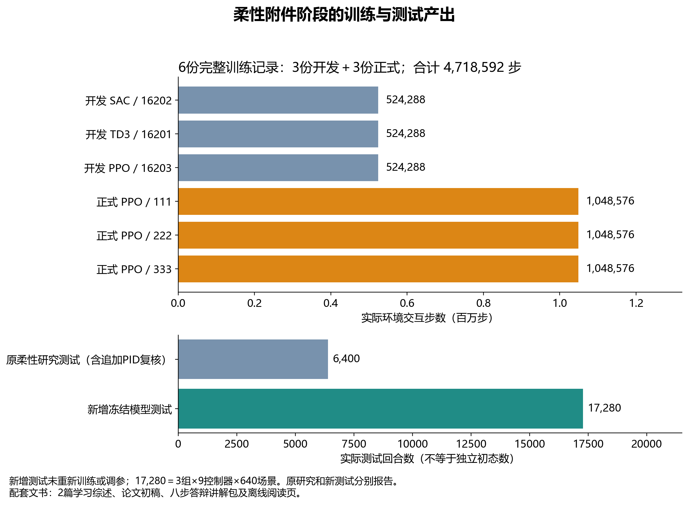

**图1 柔性附件阶段的训练与测试产出。** 开发与正式训练分列，累计交互4,718,592步；原6,400回合与新增17,280回合测试分别统计，回合数不等于独立初态数。

## 五、项目研究结题报告

### （一）主要内容

#### 1、课题背景

卫星姿态控制的任务是使卫星转向目标方向，并保持所需的指向精度，为通信、对地观测等任务提供保障。实际卫星可能带有太阳翼、天线等柔性附件。本体转动时，控制力矩会激发附件振动；附件的反作用又会影响本体姿态。因此，本体暂时对准目标，并不意味着整个系统已经稳定，姿态控制还需要兼顾残余振动[1]。

PID结构简单、计算量小，在刚体姿态调节中具有良好实用性。但普通PID主要依据本体姿态误差和角速度反馈，未显式利用附件变形信息。当任务同时要求本体对准和附件停稳时，需要进一步研究控制结构及其参数选择。

强化学习能够通过与仿真环境交互学习控制策略[2]。本项目以“人工智能在卫星姿态控制系统中的应用”为主题，从刚体姿态控制逐步转向柔性附件联合控制，重点考察：在相同时限、力矩上限和验收标准下，学习补偿能否改善既有PID方案，并通过传统方法对照明确其适用范围。

#### 2、课题研究内容与方法

首先，建立刚体姿态控制基础。单轴模型描述控制力矩作用下的角度与角速度变化；三轴模型采用欧拉刚体方程及单位四元数，保留轴间耦合。仿真统一处理力矩限幅、扰动、噪声和持续停稳要求，在共同场景中比较PID与PPO、SAC、TD3，并利用验证集整定PID参数和选择学习模型。

在此基础上，以SAC为代表开展惯量变化、一阶执行器滞后及纯延迟探索。这些实验未在本次模型和训练预算下获得稳定的学习优势，结果集中见图7。因此将其作为方法筛选依据，最终将研究重点确定为本体姿态与附件振动同时达标的任务。

其次，建立单轴双惯量柔性模型。将本体和附件表示为两个转动惯量，以弹簧和黏性阻尼描述相互作用，采用本体角度、角速度、附件相对角度和相对角速度作为状态。根据角动量关系推导动力学，并检查内部力矩方向、角动量及能量关系。本体和附件惯量分别取0.7、0.3 kg·m²，模态频率为0.4～0.8 Hz，阻尼比为0.01～0.04，用于研究给定范围内的参数变化。

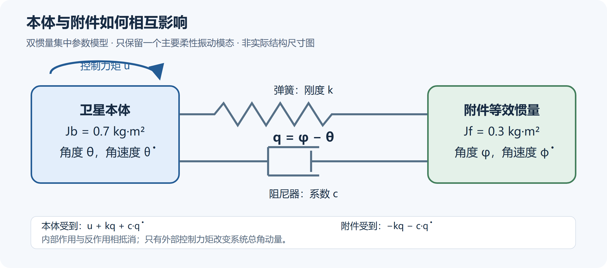

**图2 双惯量柔性附件等效模型。** 控制力矩仅作用于本体，弹簧和阻尼描述相互作用；模型参数范围和测试约束见图5。

再次，设计传统反馈与学习补偿相结合的控制方法。传统反馈依据本体角度误差和角速度提供基础力矩；入选积分增益为零，实际属于PD控制。PPO根据本体及附件测量状态等信息输出附加力矩，总指令经过限幅。补偿幅值随归一化测量状态调节，四维测量状态均为零时补偿为零，以减少策略静态偏置的影响。该约束不等同于闭环稳定性证明；含噪时真实状态为零也可能产生非零补偿。

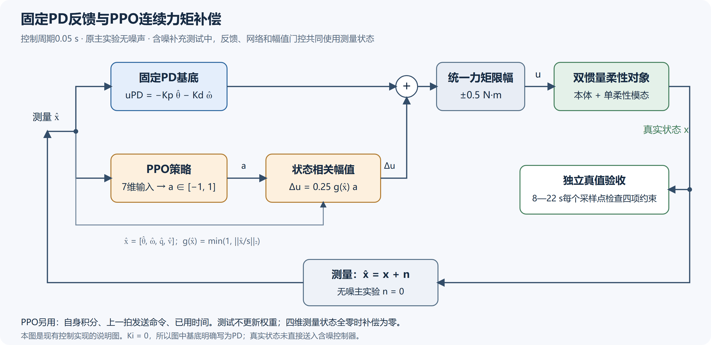

**图3 PD反馈与PPO连续力矩补偿控制结构。** 基础反馈与学习补偿相加后统一限幅；测试时网络权重固定，以测量状态控制、真实状态验收。

训练奖励综合考虑姿态误差、附件振动和力矩输出，并对第8秒后未达标及越界状态增加惩罚。开发阶段分别对SAC、TD3、PPO训练524,288步，依据验证成功率、越界情况及控制代价选择PPO[3]。随后使用三个新随机种子独立训练PPO，各执行1,048,576步，按预设验证规则保留检查点。图4展示全部训练的验证过程，正式PPO末模型均有退化，因此测试使用验证选中模型，不能称训练稳定收敛。测试不更新网络权重。

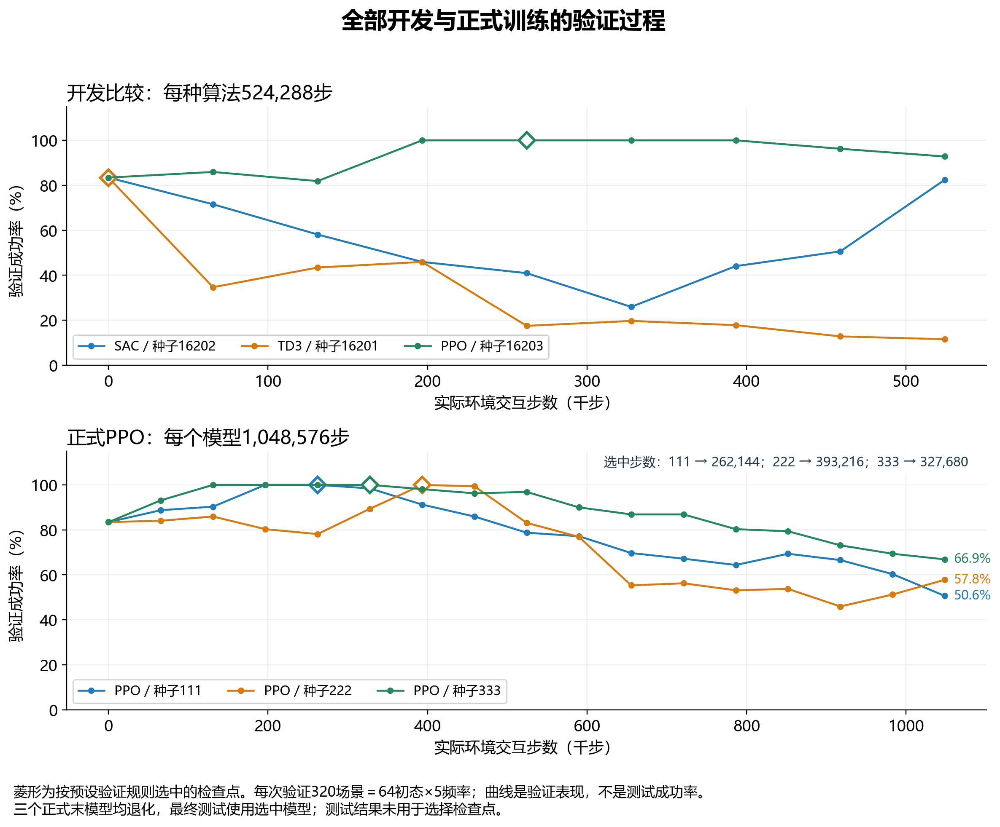

**图4 六次训练的完整验证过程。** 菱形为预设规则选中的检查点；下图三个PPO选中步数分别为262,144、393,216、327,680。验证成功率与正式测试成功率分别报告。

实验规定每回合22秒、采样周期0.05秒、力矩上限±0.5 N·m。从第8秒至第22秒，本体角误差、角速度、附件相对角度及相对角速度的绝对值，须分别持续不超过1°、0.5°/s、0.1°、0.5°/s，且整回合未触发越界，才判为成功。评价首先看成功率与越界次数，再分析振动和控制代价。控制代价取完整时域力矩平方积分，不能直接解释为实际电能。

最终设置原分布全新样本、初始小振动、初始小振动与小幅高斯测量噪声三组测试。每组由128个独立初态在五种频率下展开为640场景，由三个PPO模型及六种传统控制器共同测试，共17,280回合。传统对照包含学习补偿所用的PD控制器、两组整定PID、两组输入整形加PID及LQR；输入整形用于减少指令对振动的激励[4]。各方法复用场景与规定噪声，以真实状态验收，以测量状态控制。

统计时按独立初态成组进行配对重采样，避免将同一初态在不同频率下的结果当作完全独立样本。同时采用独立状态空间矩阵指数方法复核动力学轨迹，并复算动作、成功判定、越界及力矩代价，形成从模型到结论的核验记录。

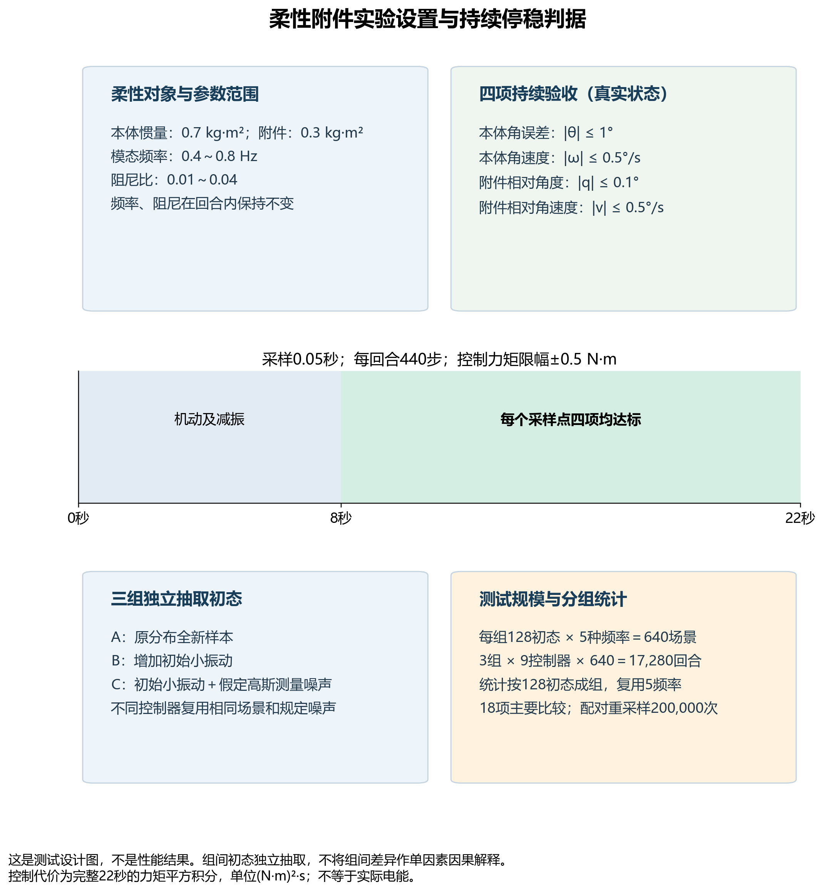

**图5 模型参数、测试规模与持续验收设计。** 四项真实状态约束在8—22秒持续检查；每组128初态×5频率，三个组与九个控制器构成17,280回合。此图表示实验设置，性能结果见图8—图11。

#### 3、研究结果

刚体阶段完成了基础模型与多算法共同评价。图6显示，三轴PID经验证整定和角速度滤波候选扩展后，成功率达到72.8%；对策略零观测输出偏置进行修正后，SAC达到63.0%，仍低于该PID结果。单轴与三轴、原始与修正部署均完整展示。

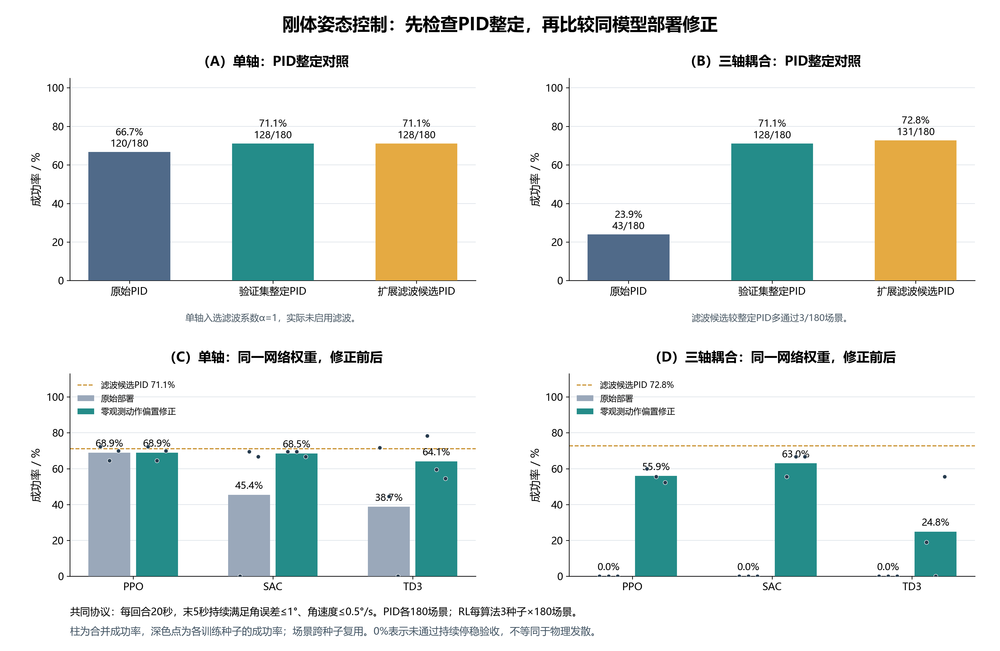

**图6 刚体姿态控制的参数整定与同模型部署修正。** 每回合20秒，末5秒持续验收；PID各180场景，学习算法每种三种子复用相同180场景。柱为合并成功率，点为各种子表现；0%不等于全部物理发散。

图7汇总前期探索。惯量域外三轴校准标称SAC通过率为100%，随机化SAC为84.4%，PID仍全部通过；较低力矩代价伴随更慢响应和更大全程误差。原执行器实验中，一阶滞后下PID与三个SAC补偿模型均全部通过，但补偿代价更高；纯延迟下学习成功率存在差异，也未形成可靠性与代价的稳定优势。

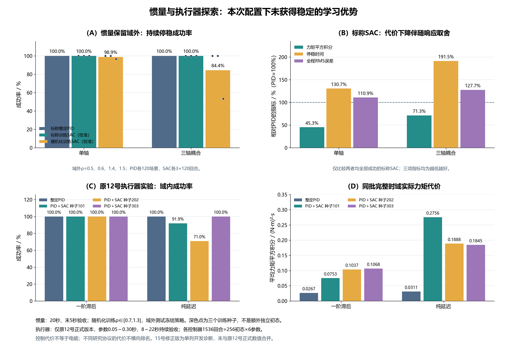

**图7 惯量变化、一阶执行器滞后及纯延迟的对比结果。** 惯量域外倍率为0.5、0.6、1.4、1.5，SAC采用校准部署；执行器面板只使用原12号正式版本，每控制器1536回合。各研究协议分开，不跨协议比较代价，不将后续修正版开发结果混入。

柔性附件最终测试中，三个独立训练的PPO模型在三组测试中，均各自通过640/640回合，未出现预设模型范围越界。补充搜索PID在三组中分别通过597、571、580回合；PPO相对其成功率分别提高约6.72、10.78、9.38个百分点。仅使用同一组PD参数、不加学习补偿时，分别通过515、509、521回合，说明在该PD控制器上加入补偿取得了任务收益。

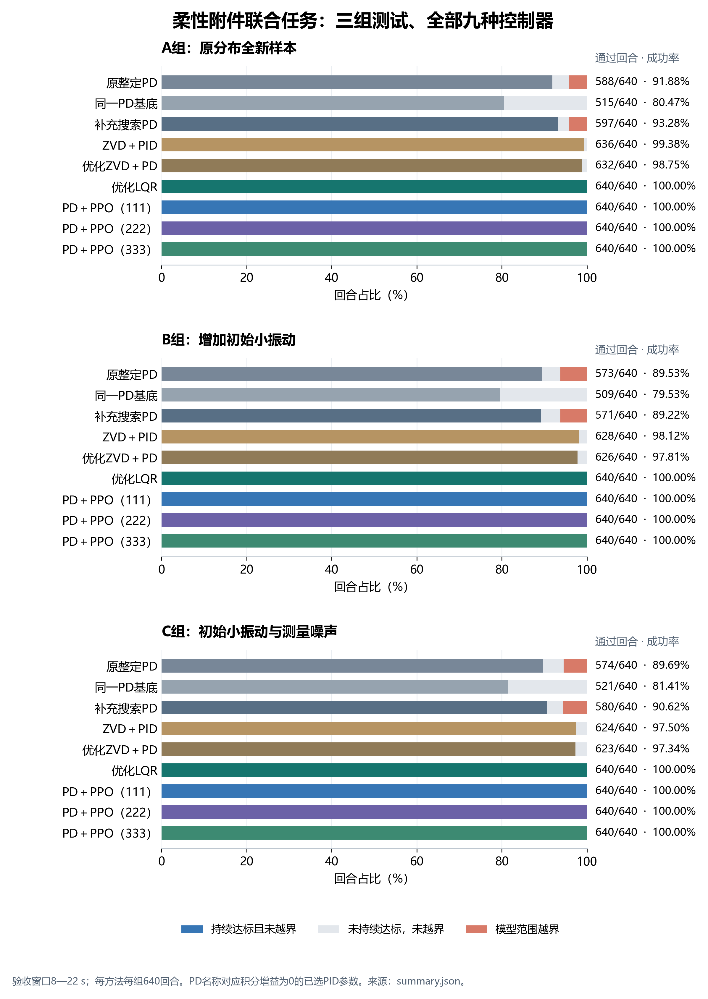

**图8 三组测试中全部九种控制器的联合任务结果。** 每方法每组640回合，区分通过、未持续达标及模型范围越界。图中PD对应积分增益为零的PID参数，不将越界解释为实物损坏。

传统完整状态反馈同样表现良好。优化LQR在三组均通过640/640回合，平均力矩平方积分均低于全部PPO模型。普通PID未显式利用柔性状态，而PPO和LQR利用了这些信息，因此性能改善也与反馈结构及信息利用方式有关，不能全部归因于强化学习算法。

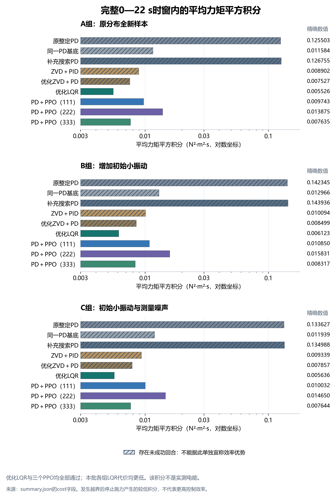

**图9 三组测试的平均力矩平方积分。** 显示完整22秒、全部九种方法的代价；横轴采用对数刻度，斜线表示存在未成功回合。LQR在同样全部成功时比三个PPO代价均低；不能将积分直接当作实际电能。

按128个初态成组计算配对区间，并对18项主要比较进行多重比较校正后，三个PPO模型相对两种PID参照的成功率差区间下界均大于零（图10）。该结果支持收益在本批全新样本和轻度条件变化下重复出现，但样本全部通过不代表任意条件下都能成功。

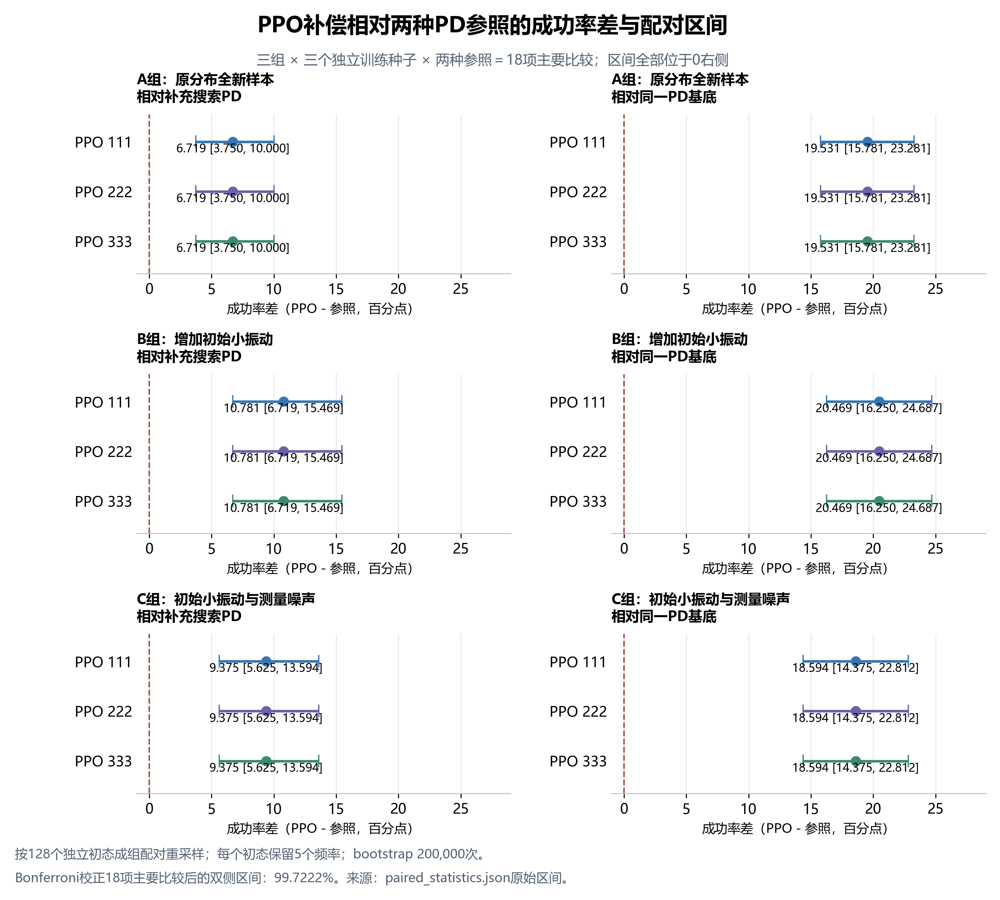

**图10 十八项主要比较的成功率差与校正区间。** 以128个初态为簇保留五频率，进行200,000次配对重采样；99.7222%区间均大于零。相同通过率不代表三个策略动作相同。

新增17,280回合包含7,603,200次状态转移，全部完成独立数值核验；最大单步推进差约为2.22×10⁻¹⁶，整段重放差约为1.56×10⁻¹⁴，动作、验收与代价复算一致（图11）。这些结果验证仿真实现和记录的一致性，不替代硬件测试或稳定性证明。

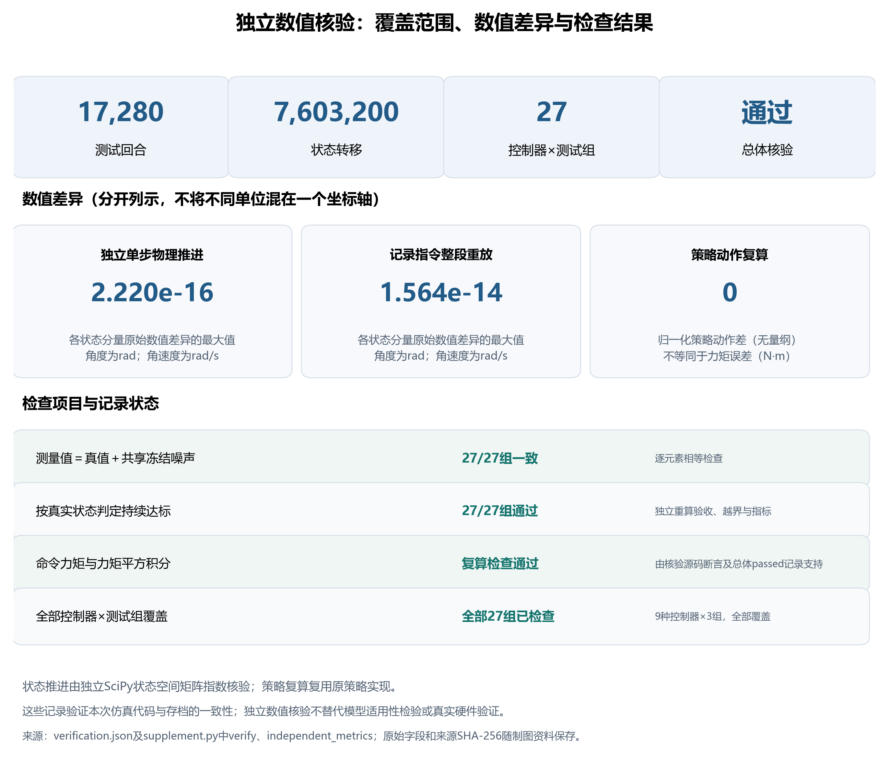

**图11 新增轨迹的独立数值核验。** 分列覆盖数量、误差最大值和检查状态；状态差按原核验记录的分量数值报告，归一化策略动作差为无量纲。原记录未给出的误差不编造为零。

#### 4、创新点

第一，围绕柔性附件建立联合评价任务。将本体姿态与附件相对振动纳入同一持续验收窗口，并结合时限、力矩和越界约束，使评价覆盖“本体对准后附件是否仍在振动”这一具体问题（图5）。

第二，完成面向该任务的PPO连续力矩补偿设计。在既有PD反馈上叠加利用柔性测量状态的补偿，并设置四维测量状态为零时补偿为零的约束（图3）。通过关闭补偿、保持PD参数相同的对照及另行整定PID，验证该方案的增量效果（图8、图10）。

第三，形成多次独立训练、共同场景测试、成组配对统计与独立物理核验相结合的实验流程（图4、图10、图11）。保留输入整形和LQR对照，完整报告成功率、振动和代价，明确学习补偿的收益与边界。上述创新属于具体任务中的方案设计和实验验证，不将PPO、双惯量模型或传统控制原理本身作为原创成果。

#### 5、结束语

本项目完成了从刚体姿态建模、多算法比较到柔性附件控制的仿真研究，并形成代码、模型、数据及报告材料。在本次单轴、单模态和给定参数范围内，PPO补偿提高了相对所比较PID的联合任务成功率；LQR全部成功且代价更低，表明传统完整状态反馈仍具有明显价值（图8、图9）。

当前研究采用理想力矩源和可测柔性状态，尚未完成三轴柔性耦合、多模态、真实传感器或硬件验证。后续可进一步研究状态估计、复杂柔性结构与硬件在环测试，检验方案在更接近工程条件下的适用性。

#### 6、参考文献

[1] WIE B. Space Vehicle Dynamics and Control[M]. 2nd ed. Reston: American Institute of Aeronautics and Astronautics, 2008.

[2] SUTTON R S, BARTO A G. Reinforcement Learning: An Introduction[M]. 2nd ed. Cambridge, MA: MIT Press, 2018.

[3] SCHULMAN J, WOLSKI F, DHARIWAL P, et al. Proximal Policy Optimization Algorithms[EB/OL]. arXiv:1707.06347, 2017. https://arxiv.org/abs/1707.06347.

[4] SINGER N C, SEERING W P. Preshaping command inputs to reduce system vibration[J]. Journal of Dynamic Systems, Measurement, and Control, 1990, 112(1): 76-82.
